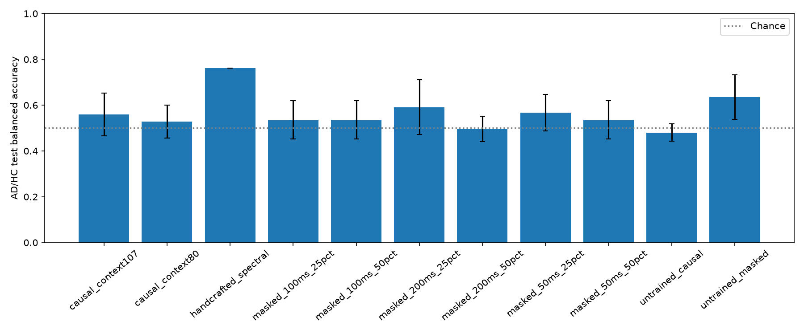

# AD versus healthy-control frozen EEG classification

Binary diagnosis readouts for every configuration in the centralized waveform study. Existing frozen encoder features are reused; no SSL retraining or new checkpoint selection. FTD is excluded from classifier fitting, validation and test scoring. **FTD training EEG remains part of the original label-free SSL pretraining.** This tests whether the same representations support AD/HC discrimination, not AD/HC-only pretraining.

Counts: {'train': {'participants': 39, 'AD': 22, 'HC': 17}, 'validation': {'participants': 13, 'AD': 7, 'HC': 6}, 'test': {'participants': 13, 'AD': 7, 'HC': 6}}. The same participant-disjoint split is preserved, rather than resplitting to improve scores. Positive class AD, negative class HC. Each participant still has one mean-pooled feature vector from the same 24 first-four-second windows. StandardScaler and fixed C=1 logistic regression are refit on AD/HC training participants only. No classifier hyperparameter sweep, threshold tuning, or test-based choices. Test BA, macro-F1 and ROC-AUC are reported. Chance balanced accuracy is now **50%**, compared with 33.3% for the earlier three-class task, so absolute accuracies cannot be interpreted as a direct model improvement across tasks.

## Test results

| model | balanced_accuracy | ba_seed_sd | macro_f1 | f1_seed_sd | roc_auc | auc_seed_sd |
|---|---|---|---|---|---|---|
| causal_context107 | 0.5595 | 0.0930 | 0.5566 | 0.0938 | 0.5794 | 0.0599 |
| causal_context80 | 0.5278 | 0.0718 | 0.5198 | 0.0648 | 0.5397 | 0.0962 |
| handcrafted_spectral | 0.7619 | — | 0.7636 | — | 0.8095 | — |
| masked_100ms_25pct | 0.5357 | 0.0833 | 0.5332 | 0.0835 | 0.4762 | 0.0476 |
| masked_100ms_50pct | 0.5357 | 0.0833 | 0.5332 | 0.0835 | 0.5159 | 0.0550 |
| masked_200ms_25pct | 0.5913 | 0.1198 | 0.5860 | 0.1158 | 0.5556 | 0.0991 |
| masked_200ms_50pct | 0.4960 | 0.0563 | 0.4698 | 0.0370 | 0.5714 | 0.0412 |
| masked_50ms_25pct | 0.5675 | 0.0793 | 0.5566 | 0.0938 | 0.5317 | 0.1787 |
| masked_50ms_50pct | 0.5357 | 0.0833 | 0.5332 | 0.0835 | 0.5635 | 0.0599 |
| untrained_causal | 0.4802 | 0.0383 | 0.4742 | 0.0338 | 0.4444 | 0.0599 |
| untrained_masked | 0.6349 | 0.0970 | 0.6260 | 0.0986 | 0.6111 | 0.0364 |

Mean and sample SD over the three paired encoders; spectral features have one deterministic classifier and no seed SD. The test cohort is smaller after excluding FTD, and has already been inspected in earlier experiments. These remain exploratory fixed-split results, not independent confirmation or a clinical diagnostic evaluation.

[Per-seed scores](eeg_binary_assets/scores.csv), [summary](eeg_binary_assets/summary.csv), [three-class versus binary point estimates](eeg_binary_assets/three_vs_two.csv). Per-participant probabilities, classifiers and confusion matrices are in `results/eeg_binary`. Reconstruction scores do not change when only downstream diagnosis labels change.

Reproduce without SSL retraining: `.venv-gpu/bin/python -m temporal_ssl.eeg_binary`.
