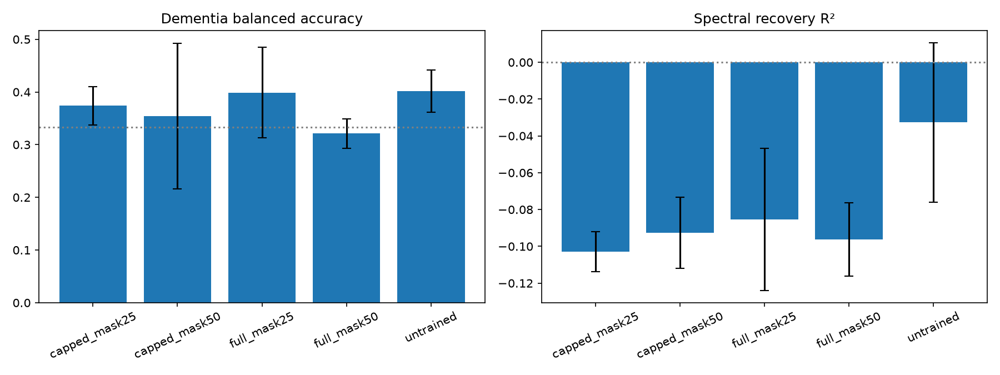
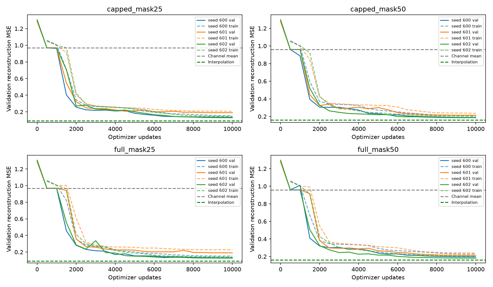
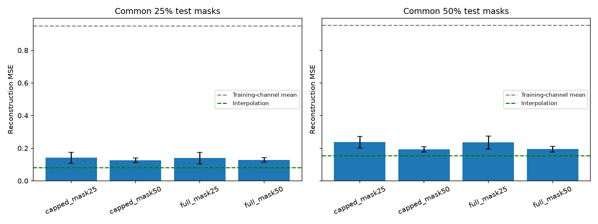

# EEG data coverage × masking ratio study

Four predeclared conditions: 24-window cap versus all usable training windows, crossed with 25% versus 50% random patch masking. Three paired initialization/sampling seeds (600–602), one fixed participant split. This is 12 independently trained models, not four single-seed comparisons. The original study artifacts are preserved.

## Pipeline and protocol

Training uses 52 participants, with 1248 capped or **4894 full windows (10.88 hours)**. Every full-cache window passed the original boundary-aware non-overlapping eight-second QC pipeline. Recording/metadata hashes, montage, native 500 Hz sampling, supplied derivative processing, and physical units are preserved. Capped windows were verified sample-for-sample as a subset of full windows. Training draws participants uniformly, then windows uniformly within participant, preventing longer recordings from dominating. Coverage counts verify every allowed window was sampled. No synthetic labels are used.

All conditions use the original capped-training-only per-channel normalization, kept identical to isolate changes in pretraining data. This remains train-only, but is intentionally not re-estimated from the expanded set. Each has **10,000 AdamW updates × 64 examples**, matched architecture (d_model=32, two layers, four heads, no dropout), learning rate 0.001 with 500-update linear warmup and cosine decay to 0.00001, weight decay .01, gradient clip 1.0. These shared optimization changes mean comparisons with earlier pilot runs are descriptive; the new factorial contrasts isolate data and masking. No architecture/hyperparameter sweep was added.

Patches are 25 samples × 19 channels (50 ms). Uniform exact-count masks hide 40 or 80 of 160 patches. All channels are hidden together. The requested span is one patch; adjacent hidden patches can form longer runs. Fast vectorized uniform-subset sampling replaces the slow sequential sampler with the same subset distribution; RNG realizations differ from historical runs. Hidden values are removed before embedding and hidden queries cannot become keys/values. Squared error scores only hidden samples.

Validation uses the same 18 participants × 24 windows, fixed masks, every 500 updates. Select checkpoints by minimum validation reconstruction at the run's training mask ratio. Full-cache preparation is deterministic and participant-local, with no population fitting. All 12 training runs finish before test EEG is supplied to a model for evaluation. No test-based tuning or optional extensions. Reconstruction is then evaluated on common 25% and 50% masks for every model, with per-ratio mean/interpolation baselines; errors across different mask ratios are different tasks.

Frozen classification and spectral probes use the identical original 24-window participant panels for all conditions (52/18/18 participants), first four seconds, no artificial masks, mean over patches then windows. This isolates pretraining data coverage rather than confounding it with more downstream averaging. The classifier remains fixed training-only standardization + C=1 logistic regression; spectral probes retain the exact 152 Welch targets and training-only input/target scaling with validation-selected ridge. Random-initialized controls use the same paired seeds. The original direct spectral classifier remains a 66.0% balanced-accuracy reference. Expanded data means more windows from the same 52 people, not more independent participants.

## Test results

Mean and sample SD across three paired seeds. These SDs measure model/sampling variability conditional on this split; they are not confidence intervals across new participants.

| condition | mean_ba | std_ba | mean_r2 | std_r2 |
|---|---|---|---|---|
| capped_mask25 | 0.3741 | 0.0364 | -0.1029 | 0.0109 |
| capped_mask50 | 0.3545 | 0.1380 | -0.0926 | 0.0192 |
| full_mask25 | 0.3989 | 0.0861 | -0.0854 | 0.0385 |
| full_mask50 | 0.3212 | 0.0278 | -0.0963 | 0.0200 |
| untrained | 0.4016 | 0.0401 | -0.0326 | 0.0433 |




Solid lines show fixed-mask validation; dashed lines show interval-average online training loss with changing masks and weights.



[Per-seed classification](eeg_factorial_assets/classification.csv), [spectral recovery](eeg_factorial_assets/spectral.csv), [common-mask reconstruction](eeg_factorial_assets/reconstruction.csv), and [paired data/masking contrasts and interaction](eeg_factorial_assets/paired_contrasts.csv) retain all values. Spectral R² uniformly averages featurewise original-unit R²; negative values are preserved. Constant targets follow the existing probe exclusion convention.

## Interpretation

Using all training windows changes mean balanced accuracy from **37.4% to 39.9%** at 25% masking, and from **35.4% to 32.1%** at 50% masking. Raising masking from 25% to 50% changes accuracy by -2.0 percentage points on capped data and -7.8 points on full data. None of the paired participant intervals for the data, masking, or interaction effects exclude zero. These results do not establish a reliable benefit or a universal harmful effect. The untrained control averages 40.2%, and the direct spectral reference remains 66.0%.

Higher-mask training helps reconstruct common missing samples: at common 50% test masks, full-data/50% averages MSE 0.194 versus 0.235 for full-data/25%. At common 25% masks the corresponding errors are 0.128 and 0.139. Thus reconstruction skill and diagnostic usefulness again differ. More data barely changes reconstruction at matched masking in this experiment.

All four trained groups have negative overall spectral R², averaging -0.103, -0.093, -0.085 and -0.096 for capped25/capped50/full25/full50, compared with -0.033 untrained. The paired spectral contrasts remain in the CSV; low linear accessibility does not prove absence of nonlinear information. The shared normalization, participant-balanced sampling, optimized masking, warmup/decay, and larger example budget improve the pipeline's practicality and reconstruction, but this experiment does not isolate those shared changes from the historical pilot.

The evidence does not support increasing masking or data volume as a sufficient fix for this particular frozen mean-pooled representation and raw-waveform objective. It leaves architecture/decoder capacity, pooling, objective/target choice, participant diversity and readout suitability unresolved. Those require separate controlled tests rather than further tuning to this already inspected test set.

## Paired participant uncertainty

| contrast | difference | lower_95 | upper_95 | replicates |
|---|---|---|---|---|
| data_at_25 | 0.0249 | -0.1270 | 0.1688 | 5000 |
| data_at_50 | -0.0333 | -0.1577 | 0.0984 | 5000 |
| masking_capped | -0.0196 | -0.1302 | 0.0952 | 5000 |
| masking_full | -0.0778 | -0.1741 | 0.0148 | 5000 |
| interaction | -0.0582 | -0.2206 | 0.1032 | 5000 |
| full50_minus_spectral | -0.3392 | -0.5746 | -0.1048 | 5000 |

These 95% percentile bootstrap intervals use 5,000 paired resamples of test participants within diagnosis, keeping all windows and all model-seed predictions for a participant together. They quantify participant sampling uncertainty conditional on the trained models and fixed split; they do not capture uncertainty from choosing new training participants. They are separate from the seed SDs above. No p-values or claims of independent confirmation are made. The [bootstrap CSV](eeg_factorial_assets/participant_bootstrap.csv) retains signed effects, including the interaction.

## Limits and reproducibility

The existing test set has already been inspected in earlier work. This is a stronger controlled exploratory study, not independent confirmation or a clinically validated diagnosis model. One participant split, only 18 test people, correlated windows, prior offline EEG preprocessing, possible participant/demographic confounding, a narrow architecture, and reconstruction-based checkpoint selection remain limitations. Neither lower reconstruction loss nor higher masking guarantees better diagnosis features. This study does not optimize masking ratio or establish a universal optimum.

```bash
CUBLAS_WORKSPACE_CONFIG=:4096:8 OPENBLAS_NUM_THREADS=1 \
  .venv-gpu/bin/python -m temporal_ssl.eeg_factorial --config configs/eeg_factorial.json
```

The command resumes saved optimizer, sampling/masking and Torch/CUDA RNG states at validation boundaries. Config/source/data audit hashes, exact source identities, coverage counts, checkpoint histories/weights, frozen features, scalers, predictions and probe validation scores are in `results/eeg_factorial`. A completed study is not silently retrained. Prior reports and source-course files are not modified.
