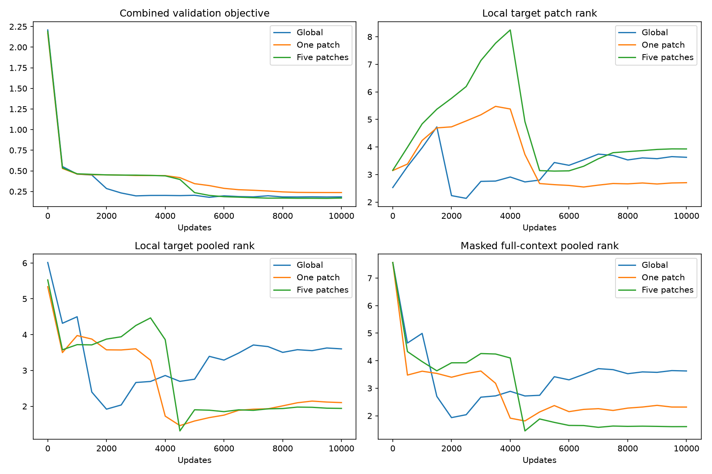

# Local target neighborhoods for masked latent prediction

Two follow-ups change only the unmasked target branch: one-patch (50 ms) or five-patch (250 ms) independent windows. The masked context branch and predictor retain full-window visible context. Shared parameters, no EMA/stop-gradient, same SIGReg applied across samples separately at each target position, same 25% masking / 50 ms patches, seed 600, full 4,894 training windows and 10,000 updates × 64 examples. No extra variance/sample objective. Original global-target results are preserved.

Each target window is encoded independently through all Transformer layers and only its center output retained. Original absolute positional encodings are used. At sequence boundaries, out-of-range tokens are masked as keys/values; they are never replicated observations. Thus a five-patch target at an interior position reads exactly two preceding and two following patches, with no multilayer propagation beyond that boundary. Target outputs do not enter the predictor.

Frozen classifiers use the same full-context unmasked encoder, first-four-second input and original participant averaging/scaling. Target branch locality does not change feature extraction. All models are validation-selected by combined objective. Diagnostics in the table describe target embeddings; they are not automatically the same as full-context downstream embeddings. This is a one-seed diagnostic on the reused 18-person test set.

| Target context | Checkpoint | Test balanced accuracy | Macro-F1 | Weights update | Target patch rank | Target pooled rank |
|---|---|---:|---:|---:|---:|---:|
| global | latent | 30.2% | 0.252 | 5500 | 3.44 | 3.39 |
| global | latent_final | 9.5% | 0.089 | 10000 | 3.62 | 3.60 |
| 1 | latent | 32.1% | 0.324 | 10000 | 2.70 | 2.10 |
| 1 | latent_final | 32.1% | 0.324 | 10000 | 2.70 | 2.10 |
| 5 | latent | 26.5% | 0.263 | 9500 | 3.93 | 1.95 |
| 5 | latent_final | 26.5% | 0.261 | 10000 | 3.93 | 1.94 |

Target diagnostics, objective components and masked-context variance/rank are saved every 500 updates in each `results/eeg_latent_local{1,5}/history.json`. Initial, selected and final weights, predictions and classifiers remain alongside them. The untrained reference is 35.7% and paired waveform reference 34.9%. CSV: [full comparison](eeg_latent_local.csv).

Reproduce: `CUBLAS_WORKSPACE_CONFIG=:4096:8 OPENBLAS_NUM_THREADS=1 .venv-gpu/bin/python -m temporal_ssl.eeg_latent_local`. Completed runs resume without extra training.

Local targets restore temporal variation: at selected checkpoints, target within-window variance is approximately 0.00266 (global), 0.4825 (one patch), and 0.5530 (five patches). Full-context feature temporal variance also increases, but pooled effective rank stays low. Diagnosis point estimates do not show a convincing gain over the untrained or waveform reference. This is evidence that fixing the measured broadcast behavior is not sufficient for diagnostic utility under the current readout; it does not prove that changing pooling would solve the problem.

Masking remains 25% with a requested 50 ms masked span. The target neighborhood is a separate parameter; it does not change patch size or masked-span length.

The objective curves use different learned targets and should not be ranked as reconstruction accuracy. Final-checkpoint rows show final weights and corresponding diagnostics; primary rows follow validation selection.
