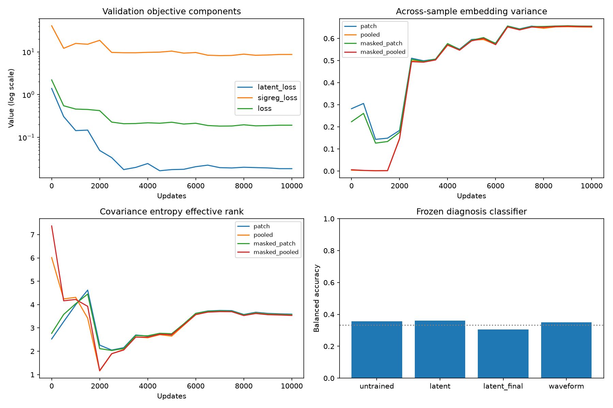

# Shared-encoder masked latent prediction EEG baseline

LeJEPA-inspired adaptation, not a reproduction of LeJEPA. One configuration and seed (600), with no sweep or adaptive regularization. Predict learned original-sequence patch embeddings rather than raw EEG samples. The existing waveform experiments and source course repository are unchanged.

## Architecture and gradient paths

The encoder is the existing two-layer, 32-dimensional, four-head Transformer, including its final affine LayerNorm, fixed sinusoidal positions and mean pooling. Original and masked sequences call the **same encoder object**. Hidden raw values are replaced before embedding and cannot become keys/values. A separate one-layer, width-32 Transformer plus linear 32→32 output maps the complete contextualized masked-branch sequence to latent predictions. It receives the masked-position contextualized vectors directly, without replacing them with fresh predictor mask tokens or adding positional encodings twice. Predictor keys/values are visible positions only; masked positions remain queries. The original-sequence embeddings never enter the predictor.

Loss is `masked_latent_MSE + 0.02 * SIGReg(original_embeddings)`. Gradients flow through predictions, predictor, masked encoder branch **and original target branch**. No EMA, detach/stop-gradient, projector, sample-level penalty, or auxiliary objective. The waveform head is removed; encoder capacity stays identical. This model has 54,560 parameters including 13,824 predictor/output parameters, versus 56,411 for the waveform model; counts are also saved in the audit. Frozen features use the original/unmasked encoder only; predictor is discarded for diagnosis evaluation.

## SIGReg definition and scope

No existing implementation was found locally. The implementation follows the sliced Epps–Pulley statistic in the [official LeJEPA minimal example](https://github.com/rbalestr-lab/lejepa/blob/main/MINIMAL.md) and [reference quadrature](https://github.com/rbalestr-lab/lejepa/blob/main/lejepa/univariate/epps_pulley.py). This is an independent small implementation of that mathematical statistic; no package dependency or vendored upstream code is introduced.

For each of the 160 positions separately, B original patch embeddings are projected onto 64 freshly sampled unit Gaussian directions. Empirical cosine/sine means across **B**, not across time, are compared to exp(-t²/2). Use 17 knots on [0,3], Gaussian weighting exp(-t²/2), trapezoidal endpoints, doubled weights for the negative half, and the reference statistic's factor B. Average over directions and positions. Do not center, standardize, or whiten the embeddings before SIGReg. This preserves penalties for shifted/scaled/non-Gaussian populations. Positions therefore cannot supply spurious diversity for a position-only collapsed encoder. Compared with the reference minimal example's 256 slices, 64 reduces compute in this initial patch-level baseline. The user's unweighted latent term plus λ-weighted regularizer is used, rather than a `(1-λ)` coefficient on prediction.

Patch positions are correlated and windows can share participants, so the independence assumptions of an ideal Gaussian goodness-of-fit test do not hold literally. Batch sampling balances participants. The existing final LayerNorm also constrains each embedding to an affine hyperplane (rank at most 31 of 32) and fixes pre-affine norm: exact full-dimensional Gaussianity is unattainable. It is intentionally retained to match the waveform encoder. SIGReg is an approximate anti-collapse pressure here, not a guarantee of exact Gaussian features or useful pooled representations.

## Data, budget and selection

All 4,894 usable eight-second windows from 52 training participants; same source hashes, preprocessing/QC, original training-only channel scaling and participant-balanced sampling as the full-window factorial study. Patch size 25 samples/50 ms, 25% hidden patches across all channels, requested span 200 ms (4 patches; adjacent masks can merge). Same 10,000 updates × batch 64, AdamW .001, 500-step warmup/cosine decay to .00001, weight decay .01, clipping 1.0. Sampling and masking streams are paired with `results/eeg_factorial/full_mask25/seed_600`. Every allowed training window was visited (4894), with 640,000 total draws. Predictor/two branches and SIGReg increase compute, so this matches updates/examples rather than wall time.

Validation uses the original 18 participants/432 windows, fixed masks, and a fixed shuffled window order to mix participants within batches. SIGReg directions are fixed across validation calls via a separate RNG, including the final smaller batch. Combined loss is sample-weight averaged across batches. Select minimum **combined validation objective** among trained checkpoints, not latent MSE alone (a collapsed representation can trivially lower prediction error). Selected update: **7000**. No labels or test features choose encoder checkpoints.

The training loop logs mean online latent MSE, SIGReg and combined loss each 500 steps. At the same intervals, fixed validation monitoring measures original and masked embedding variance/effective rank at patch and pooled levels. Patch statistics compute covariance across samples independently at each position, then average; pooled statistics compute covariance across mean-pooled windows. Effective rank is exp(entropy(normalized covariance eigenvalues)); zero covariance gives zero rank. These are descriptive collapse checks, not extra losses. The fixed first 64 shuffled validation windows are used throughout, avoiding a moving diagnostic population. Participant-level frozen features average the same 24 four-second observations as the waveform baseline, with original training-only scaling and fixed C=1 logistic regression. As in the waveform baseline, four-second unmasked feature extraction differs from eight-second SSL training; that shared observation protocol is retained rather than silently changed.

The waveform row is the original 50 ms reference, not a newly trained matched-span waveform model. This follow-up changes only the latent model’s mask span; it retains the original SIGReg and predictor settings.

## Initial results

This follow-up changes only the mask span. Classification and collapse statistics below are the measured outcomes; no extra objective was added.

| model | split | balanced_accuracy | macro_f1 |
|---|---|---|---|
| untrained | validation | 0.4349 | 0.4360 |
| untrained | test | 0.3571 | 0.3316 |
| latent | validation | 0.4524 | 0.3818 |
| latent | test | 0.3603 | 0.3333 |
| latent_final | validation | 0.3413 | 0.2559 |
| latent_final | test | 0.3048 | 0.2348 |
| waveform | validation | 0.3683 | 0.3648 |
| waveform | test | 0.3492 | 0.3148 |

At the selected checkpoint, original patch variance is **0.643183**, patch effective rank **3.747**, pooled variance **0.639147**, pooled effective rank **3.709**. See the full traces rather than interpreting a low latent loss as success. `untrained` is this model's exactly paired initial encoder; `waveform` is the same seed/configuration's existing full-data/25% masked raw decoder. Raw-voltage and latent losses have different targets and units and are not directly ranked.

The same fixed 64-window validation panel also gives the following encoder-only diagnostics. Within-window variance is an extra **diagnostic**, not an added regularizer: small temporal variation combined with substantial pooled variance can reveal a window-level code broadcast across positions.

| model | patch_variance | patch_effective_rank | pooled_variance | pooled_effective_rank | within_window_variance |
|---|---|---|---|---|---|
| untrained | 0.2822 | 2.5269 | 0.0038 | 6.0133 | 0.5357 |
| latent | 0.6432 | 3.7470 | 0.6391 | 3.7093 | 0.0042 |
| latent_final | 0.6546 | 3.5889 | 0.6513 | 3.5626 | 0.0033 |
| waveform | 0.0492 | 1.4420 | 0.0002 | 2.8511 | 0.0492 |



This is one exploratory seed on the already inspected 18-person test set. Nonzero patch variance does not guarantee useful sample-level features. No sample-level regularizer is added to repair pooled collapse in this baseline. The final checkpoint is also evaluated, so regression or a misleading minimum is visible. Untrained and waveform controls use matched access and observations. No spectral probe, nonlinear readout, or optimization sweep was added.

## Reproduce

```bash
CUBLAS_WORKSPACE_CONFIG=:4096:8 OPENBLAS_NUM_THREADS=1 \
  .venv-gpu/bin/python -m temporal_ssl.eeg_latent_experiment --config configs/eeg_latent_span200.json
.venv-gpu/bin/python -m pytest -q tests/test_eeg_latent.py
```

Checkpoints retain optimizer and independent sampling, masking, SIGReg, Torch and CUDA RNG states. Re-running resumes the identical protocol; config mismatches stop explicitly. Exact validation masks/order, untrained/best/final states, histories, frozen features, predictions, fitted classifiers and audit/source hashes are in `results/eeg_latent_span200`. [Objective/diagnostics CSV](eeg_latent_span200_assets/history.csv), [classification CSV](eeg_latent_span200_assets/comparison.csv), [training audit](eeg_latent_span200_assets/training_audit.json).
