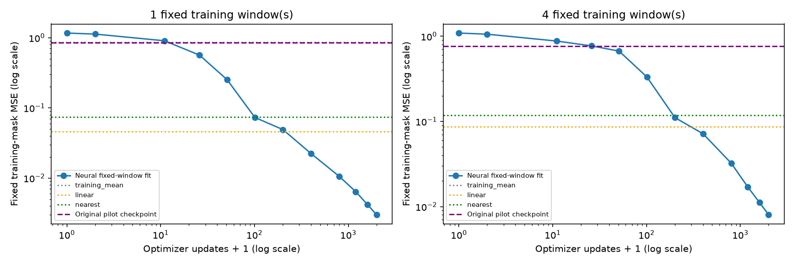
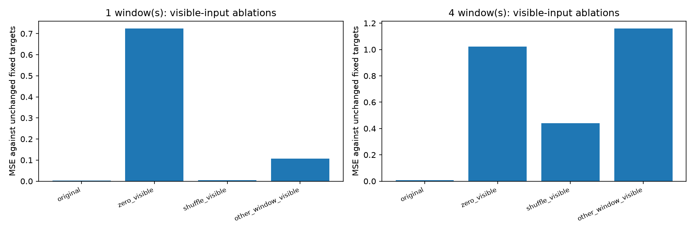
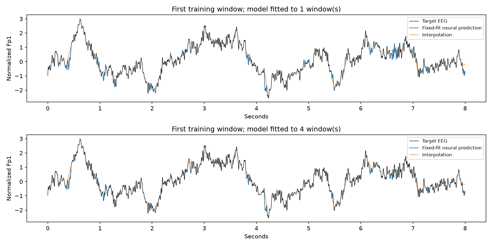
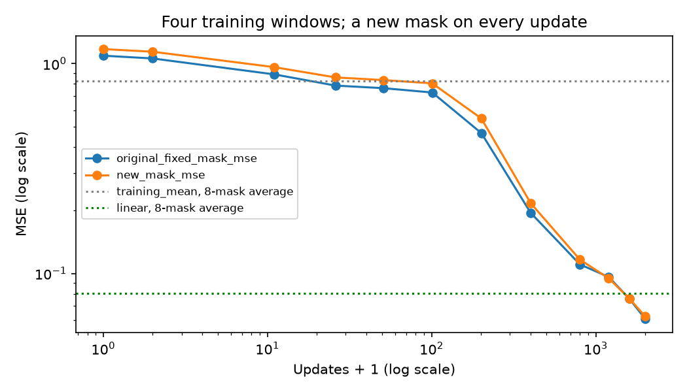

# EEG learning sanity checks

Training-only diagnostic: 2000 updates on one and four fixed 8-second EEG windows, using fixed 25% short-patch masks. Same 56,411-parameter model, initialization, AdamW settings and original training normalization as the pilot. No held-out EEG is loaded and no model settings are tuned. Participants: sub-001, sub-066, sub-037, sub-002.

These are memorization/input-sensitivity tests, not validation, classification or generalization results. Mask/optimizer seeds, exact selected windows and normalized inputs are saved.

| Fixed windows | Initial MSE | Pilot checkpoint MSE | Fixed-fit MSE | Training mean | Interpolation | New-mask MSE (same windows) |
| --- | ---: | ---: | ---: | ---: | ---: | ---: |
| 1 | 1.166147 | 0.853482 | 0.003004 | 0.857720 | 0.045787 | 0.410378 |
| 4 | 1.090349 | 0.760868 | 0.008031 | 0.761280 | 0.086784 | 0.804876 |

## Visible-input dependence

All ablations change visible patches only. Hidden targets stay unchanged. Shuffle permutes visible patches within each window; other-window replacement uses another training participant, never validation/test data.

| Windows | Original MSE | Zero visible MSE | Shuffled visible MSE | Other-window visible MSE | Masked-value perturbation max prediction change |
| --- | ---: | ---: | ---: | ---: | ---: |
| 1 | 0.003004 | 0.723732 | 0.004079 | 0.106739 | 0.0 |
| 4 | 0.008031 | 1.021533 | 0.439583 | 1.158810 | 0.0 |

Prediction-change RMS values and visible/hidden input gradients are in `summary.json`. Hidden-value perturbation must leave predictions unchanged, and the gradient of predictions with respect to hidden inputs must be zero. Finite input sensitivity does not prove the model learned interpolation.

The optional affine-head rank bound is the minimum MSE obtainable by any rank-d_model centered output matrix on these targets. It follows from the shared linear output head and is a necessary capacity bound, not a guarantee that the encoder can attain it.

A low fixed-mask training loss can reflect memorizing positions/windows. New masks on the same fitted windows are a harder diagnostic but still do not test held-out participant generalization. Data-scaling conclusions require more evidence than these checks.





```bash
CUBLAS_WORKSPACE_CONFIG=:4096:8 OPENBLAS_NUM_THREADS=1 \
  .venv-gpu/bin/python -m temporal_ssl.eeg_learning_checks --pilot results/eeg_pilot --output results/eeg_learning_checks --steps 2000
```
Use a new output directory for another run.

## Four-window resampled-mask control

Same four windows, initialization, architecture, optimizer and 2000 updates; only the mask changes each update, as in the original pilot. No hyperparameter search.

Original fixed-probe MSE: **0.060791**. New-mask MSE on the same windows: **0.062484**.

Across eight independently sampled evaluation masks on those same four training windows: neural MSE **0.061769**, interpolation **0.080203**, nearest **0.117522**, training mean **0.824339**. The eight masks assess mask variability, not independent participant generalization.



## Unfitted windows from the same training participants

Inference only on cached window 1 (rather than fitted window 0) from each of the same four training participants, using eight evaluation masks. No additional optimization or held-out participant EEG. Neural MSE **1.225725**, interpolation **0.071590**, nearest **0.102531**, training mean **0.784380**.

This distinguishes fitting the four waveforms from transfer to another window. It is still not an independent-subject validation result.

## Interpretation

Low loss on fixed windows/masks verifies that the optimizer, gradient path and model can fit these EEG targets; it does not verify learned interpolation. The resampled-mask control asks whether fitting survives changes of hidden positions on the same waveforms. The unfitted-window check asks whether that behavior transfers to different waveforms from the same participants. Neither is a held-out-subject benchmark.

Each tiny-case window is presented 2000 times, once per update. The original pilot budget presented each window only 20 times (its selected checkpoint can be earlier). Thus this deliberately changes repetition/exposure as well as dataset size; it cannot establish that adding data hurts, or that a longer full-data run would necessarily solve the problem.

These checks do not establish a need for foundation-model-scale data. If new-mask fitted-window errors are low but unfitted-window errors are high, focus next on learning a transferable reconstruction rule, with controlled training exposure and patch/context design. A temporally labeled EEG dataset can improve the scientific evaluation target, but switching datasets does not itself fix this learning issue.
