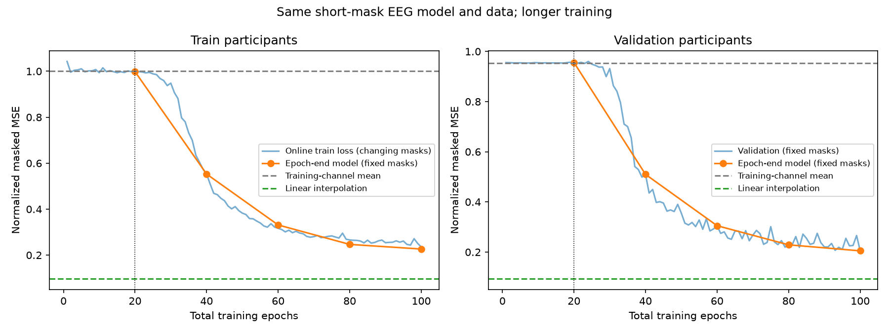
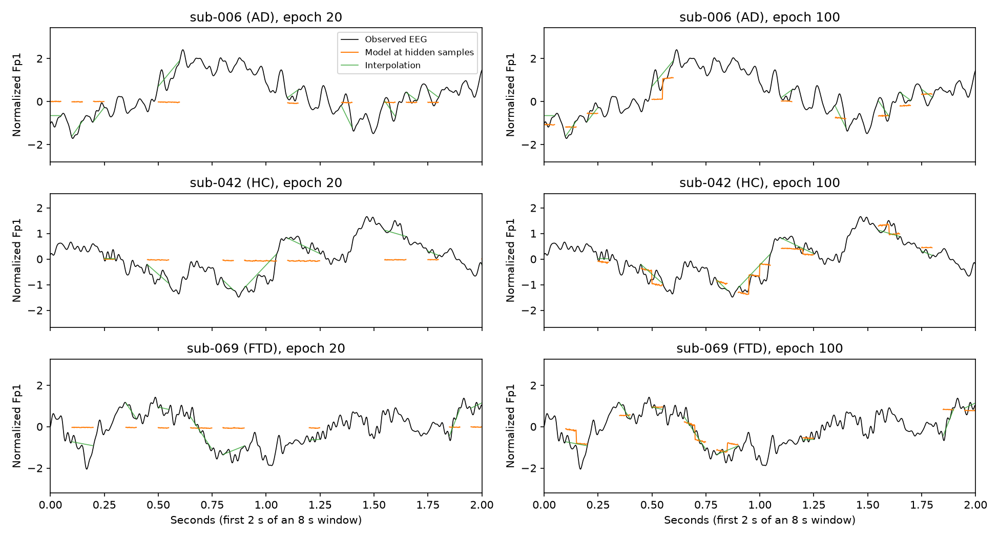

# Longer short-mask EEG training diagnostic

Question: does the near-mean pilot reconstruction improve with more training on the same data, or does fitting separate from validation generalization?

Continued the original epoch-20 `masked_short/last.pt` to **100 total epochs**, preserving model, AdamW, shuffle/mask RNG, Torch/CUDA RNG, and validation-selected best state. The original pilot artifacts are unchanged. Same 56,411-parameter model, 25-sample (50 ms) patches, 25% masked reconstruction, batch size 16, learning rate 0.001, weight decay 0.01, clip 1.0, seed 600. No architecture/optimizer/data sweep. Each training epoch uses new masks.

The original 52 training participants (1,248 windows) and 18 validation participants (432 windows) are loaded. All 8 s × 19-channel windows and training-only channel normalization are unchanged. **No test participant EEG is loaded or evaluated.** This is a diagnostic using the existing validation split, not a fresh held-out confirmation. Epochs 20–100 correspond to 7,800 total optimizer updates and 100 presentations per training window.

Fixed evaluation masks use seed 604 for training and 603 for validation, matching the original validation-loss protocol. The same missing samples are scored for models, channel-mean zero predictions, and visible-sample interpolation. Metrics first average epochs within participant, then participants; all participants have 24 windows. Online training loss averages losses while weights and masks change; epoch-end fixed-mask training loss evaluates a single checkpoint. Their curves have different sampling conventions.

## Fixed-mask reconstruction

| Baseline | Train MSE | Validation MSE |
|---|---:|---:|
| training_mean | 1.000040 | 0.953776 |
| linear | 0.096695 | 0.093268 |
| nearest | 0.139275 | 0.135814 |

| Checkpoint | Train MSE | Validation MSE | Train prediction RMS | Validation prediction RMS |
|---|---:|---:|---:|---:|
| 20: last | 0.998311 | 0.955901 | 0.0368 | 0.0368 |
| 20: best | 0.998366 | 0.953632 | 0.0224 | 0.0211 |
| 40: last | 0.552687 | 0.509745 | 0.6154 | 0.6066 |
| 40: best | 0.533301 | 0.498833 | 0.7188 | 0.7107 |
| 60: last | 0.331167 | 0.305122 | 0.7321 | 0.7200 |
| 60: best | 0.317549 | 0.284301 | 0.8924 | 0.8809 |
| 80: last | 0.246557 | 0.228872 | 0.8965 | 0.8863 |
| 80: best | 0.244147 | 0.219764 | 0.8973 | 0.8843 |
| 100: last | 0.226419 | 0.204913 | 0.8690 | 0.8584 |
| 100: best | 0.226419 | 0.204913 | 0.8690 | 0.8584 |

`last` is the model after that total epoch count. `best` is the lowest validation-loss state seen by that milestone; it may come from an earlier epoch. Final selected epoch: **100**, validation MSE **0.204913**. Prediction RMS measures the size of the output around the training-channel means (zero in normalized units); target RMS is recorded in the numerical results for context. Low output RMS together with near-mean error supports the visual impression of small-amplitude predictions.




## Interpretation

At the final epoch, reconstruction reduces MSE versus the fitted channel-mean baseline by **77.36% on training** and **78.52% on validation**. From epoch 20 to 100, fixed-mask train MSE changes from 0.998311 to 0.226419; validation changes from 0.955901 to 0.204913. Both training and validation reconstruction improve substantially on unchanged data. The original 20-epoch pilot was too short for this configuration to leave its near-mean behavior. This supports training duration as an important contributor to that earlier failure, rather than establishing that more training data was required. Final validation error is still 2.20 times the linear interpolation error; the remaining reconstruction gap should not be overlooked.

This is one seed and one unchanged learning rate/budget extension. It cannot rule out improvements with other optimization settings or more data. It evaluates masked waveform reconstruction, not causal predictability or diagnosis accuracy; no classifier was retrained. Earlier classification and spectral-probe results still refer to the original pilot checkpoints. They cannot be assumed to describe these longer-trained weights, or used to establish an intrinsic limitation of the SSL objectives.

## Reproducibility

```bash
CUBLAS_WORKSPACE_CONFIG=:4096:8 OPENBLAS_NUM_THREADS=1 \
  .venv-gpu/bin/python -m temporal_ssl.eeg_long_training \
  --pilot results/eeg_pilot --output results/eeg_long_training --epochs 100
# To continue an interrupted run, add --resume with the identical configuration.
```

Use a new output directory for a fresh repeat. The runner copies the original last checkpoint into its own directory; it never writes to the pilot. It saves the exact evaluation masks, per-window/per-participant metrics, examples, original checkpoint hash, input/configuration/code hashes, original and extended training history, and continuation checkpoints. Runtime: 229.0 seconds including cache loading, baselines, training, and evaluation (excluding final report rendering).

Numerical results: [fixed evaluations](eeg_long_training_assets/fixed_evaluations.csv), [epoch history](eeg_long_training_assets/history.csv), [baselines](eeg_long_training_assets/baselines.json).
