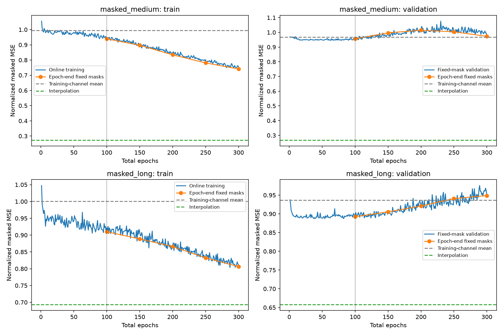

# Medium/long masked EEG: longer training

Continued the two original **100-epoch** runs to **300 total epochs** on the RTX 3090. Same 52 training participants (1,248 windows), 18 validation participants (432 windows), 19 channels, eight-second windows, 50 ms patches, 25% masking, requested 200/600 ms spans, initialization seed 600, AdamW learning rate 0.001, batch size 16, weight decay 0.01 and gradient clip 1.0. The model, optimizer, shuffle/mask RNG and Torch/CUDA RNG states were resumed exactly. The fixed epoch budget was set before observing this continuation. No architecture or optimizer sweep.

**No test EEG was loaded, and no dementia classifier or spectral probe was fitted.** Causal and short-mask runs were not extended. Original 100-epoch results and reports are preserved; outputs are in `results/eeg_masked_300`.

## Reconstruction

| model | checkpoint | weights_epoch | train_mse | validation_mse | validation_prediction_rms |
|---|---|---|---|---|---|
| masked_medium | 100: last | 100 | 0.939378 | 0.955635 | 0.212041 |
| masked_medium | 300: last | 300 | 0.741304 | 0.972758 | 0.433195 |
| masked_medium | 300: best | 79 | 0.960732 | 0.945594 | 0.138213 |
| masked_long | 100: last | 100 | 0.909913 | 0.892498 | 0.264743 |
| masked_long | 300: last | 300 | 0.806247 | 0.948869 | 0.356106 |
| masked_long | 300: best | 54 | 0.931466 | 0.887326 | 0.245887 |

`last` evaluates the model at that total epoch; `best` evaluates the minimum-validation-loss checkpoint among all epochs 1–300. The label `300: best` describes the selection budget, not necessarily the epoch of its weights. Both final and selected states are reported to expose overfitting or regression. Prediction RMS measures output amplitude around the training-channel means; target RMS is retained in the numerical data.

| model | split | mean_mse | interpolation_mse |
|---|---|---|---|
| masked_medium | train | 0.995464 | 0.272878 |
| masked_medium | validation | 0.967014 | 0.266923 |
| masked_long | train | 1.000491 | 0.693328 |
| masked_long | validation | 0.936579 | 0.657883 |

Models and baselines use identical fixed hidden samples: mask seed 604 for training, 603 for validation. Validation masks match the training loop's checkpoint-selection protocol. Model evaluation averages window MSE within participants and then across participants. Online training loss uses changing masks and changing weights, so it need not match epoch-end fixed-mask loss. Interpolation only uses visible samples. Mask spans can merge/truncate, just as in the pilot.



## Measured changes

- masked_medium: epoch-100 → epoch-300 validation MSE 0.955635 → 0.972758; selected epoch 79 has validation MSE 0.945594 (2.22% below the mean baseline).
- masked_long: epoch-100 → epoch-300 validation MSE 0.892498 → 0.948869; selected epoch 54 has validation MSE 0.887326 (5.26% below the mean baseline).

Neither continuation produced a better validation checkpoint than the original 100-epoch sweep. The decline in training error without a corresponding validation decline supports overfitting rather than a delayed training transition at these settings. Extending the same settings further is not supported by these curves. This does not rule out improvements with a changed optimization or reconstruction design, or additional data.

The measured trajectories distinguish a delayed reduction in both errors from continued near-mean behavior or training/validation separation. They do not establish whether more EEG data, another learning rate, or a different decoder would help. These are one-seed diagnostics on an already inspected validation split, not independent test confirmation. Reconstruction performance alone does not establish dementia classification or spectral-information quality.

## Reproduce

```bash
CUBLAS_WORKSPACE_CONFIG=:4096:8 OPENBLAS_NUM_THREADS=1 \
  .venv-gpu/bin/python -m temporal_ssl.eeg_masked_extension \
  --pilot results/eeg_pilot_100 --output results/eeg_masked_300 --epochs 300
# Add --resume to continue an interrupted run with identical settings.
```

Use a new output directory for a separate repeat. Saved artifacts include source checkpoint/configuration/normalization hashes, source-code snapshot hashes, unchanged original history prefixes, continuation checkpoints with optimizer/RNG state, exact evaluation masks, per-window and per-participant errors, fixed-mask reconstruction examples at each milestone, baseline errors, and [summary CSV](eeg_masked_300_assets/summary.csv) / [milestone CSV](eeg_masked_300_assets/fixed_evaluations.csv) / [baseline CSV](eeg_masked_300_assets/baseline_summary.csv). Tests for fixed-mask alignment and exact continuation through diagnostic evaluation are in `tests/test_eeg_long_training.py`.
