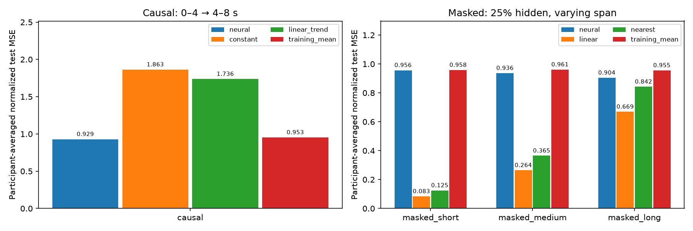
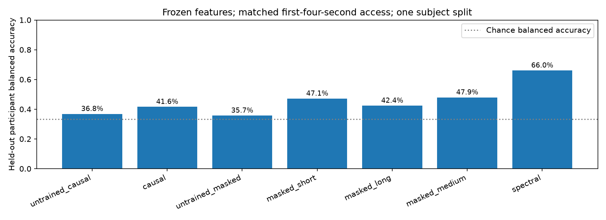
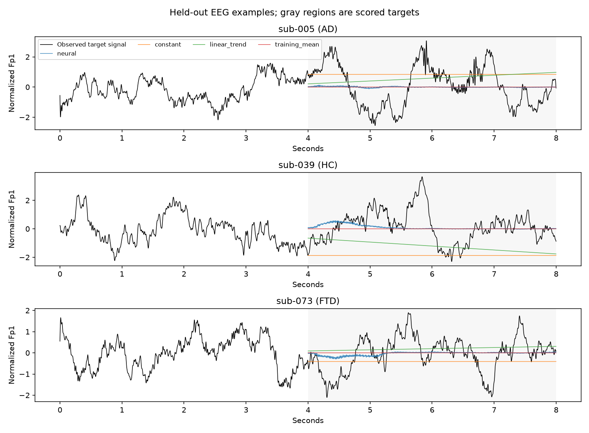
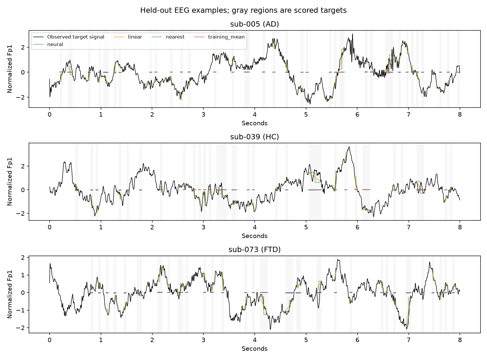
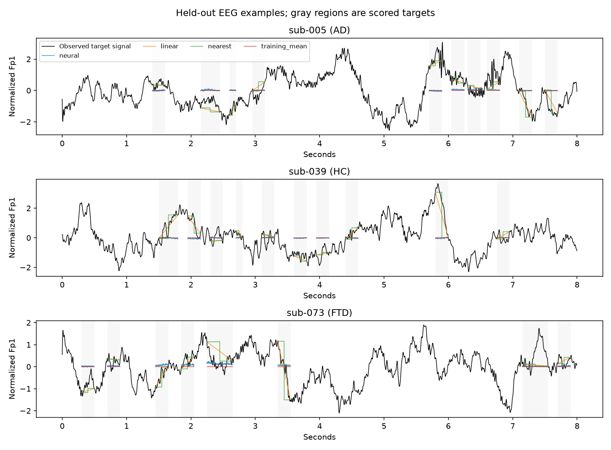
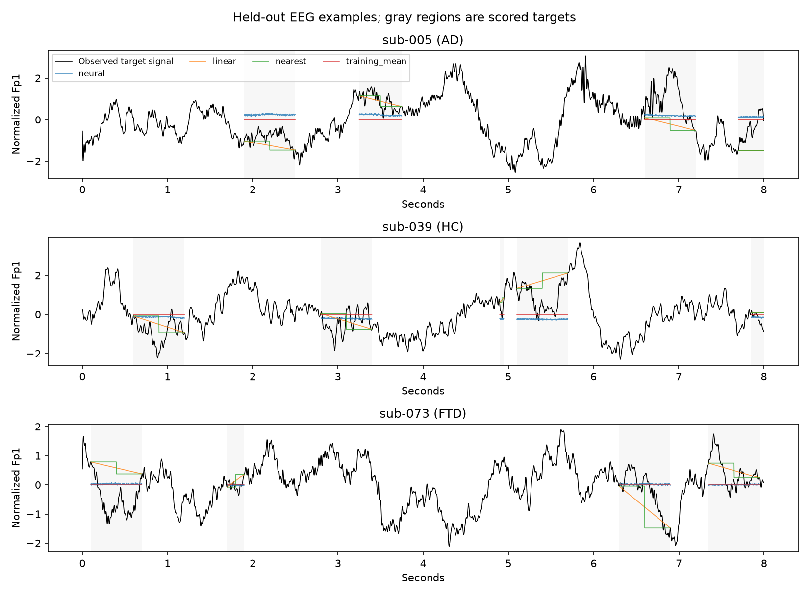

# EEG SSL pilot — ds004504

## Research question

How does the length of contiguous masked regions affect bidirectional self-supervised EEG representation learning, compared with a fixed causal future-prediction baseline?

## Experimental setup

This is an exploratory, inductive **single participant-disjoint split**, not cross-validation. Pretraining and classifier fitting use training participants only. Diagnostic labels are used for stratification and downstream classification, never SSL loss. One data/initialization seed is used; there is no hyperparameter search.

Dataset: OpenNeuro ds004504, version 1.0.9. All 88 participants have usable recordings (36 AD, 23 FTD, 29 HC). We reuse the course-project amplitude-preserving EEGLAB loader, canonical channel handling, metadata diagnosis mapping, boundary-aware epoch extraction, and Welch spectral features. No original course-project files were modified. 

The supplied derivatives were already cleaned by their authors: histories include 0.5–45 Hz `pop_eegfiltnew`, ASR, ICA and ICLabel component removal. We preserve the supplied A1/A2 reference, filtering and artifact handling, with no additional filtering, resampling, rereferencing or per-epoch normalization. Source documentation calls the filter Butterworth, while histories use EEGLAB FIR; raw documentation/sidecars also disagree on reference/filter details. The verified derivative samples and headers are authoritative for this pilot. Offline provider filtering/cleaning may depend on future samples within a recording; model-level causality applies to the supplied derivative sequence and is not a strict online/raw-EEG causality claim.

The complete 19-channel montage is Fp1, Fp2, F3, F4, C3, C4, P3, P4, O1, O2, F7, F8, T3, T4, T5, T6, Fz, Cz, Pz. Native microvolt amplitudes are retained in the cache. Non-overlapping 8-second epochs restart at every discontinuity identified from `clean_sample_mask`, checked against EEGLAB boundary events. Nonfinite/flat-channel epochs are rejected (flat peak-to-peak ≤1e-6 µV); >1,000 µV is a review flag only. No epoch crosses a provider-removed gap. Supplied offline preprocessing is independent per recording; we fit no preprocessing across held-out participants.

To keep the pilot small and participant contributions balanced, at most 24 usable epochs are selected per participant using evenly spaced indices across the recording. This is a documented subsample of the original course pipeline, not all available epochs. Exact selected starts and source checksums are cached. Channel mean/std are fit across selected **training** observations only and then fixed for every model and split. Spectral features are computed on physical microvolts before this SSL normalization.

| Partition | Participants | AD / FTD / HC | Selected epochs |
| --- | ---: | --- | ---: |
| train | 52 | 22 / 13 / 17 | 1248 |
| validation | 18 | 7 / 5 / 6 | 432 |
| test | 18 | 7 / 5 / 6 | 432 |

Sampling: **500 Hz**, 19 channels, 4000 samples per epoch. Shared patch: **25 samples / 50 ms**; 160 patches per 8 seconds.

**Causal task:** only 0–4 seconds are observation tokens; predict every sample/channel in 4–8 seconds simultaneously. The same Transformer processes causal source tokens plus position-only future queries. Queries never become keys/values at any layer; future observation values are never embedded. The same linear patch head maps each query state to an observation patch. There is no autoregressive rollout or teacher forcing. This is an explicit extension of the synthetic individual-future-patch loss; the original synthetic objectives are unchanged.

**Masked tasks:** 25% of whole patches are hidden, keeping the total count fixed while varying requested contiguous span. Masked values are replaced before embedding; only visible keys/values are accessible. Blocks can merge or truncate. Actual held-out run-length histograms, exact masks and summary counts are saved for each run.

| Mask condition | Requested patches | Requested duration | Realized median / mean / max |
| --- | ---: | ---: | --- |
| masked_short | 1 | 50 ms | 50 / 66 / 450 ms |
| masked_medium | 4 | 200 ms | 200 / 214 / 800 ms |
| masked_long | 12 | 600 ms | 600 / 522 / 1900 ms |

All four models: width 32, 2 Transformer layers, 4 heads, 56,411 allocated parameters each; AdamW lr=0.001, batch=16, **20 epochs / 1560 updates**, seed=600, device=cuda. Same initialization and optimizer budget; only mask span changes among masked models. Each run selects its minimum validation reconstruction loss checkpoint. Full histories/checkpoints are retained.

**Classification access is matched:** every neural and spectral method uses **0–4 seconds only** from each selected 8-second epoch. Causal attention uses past/current source patches; masked embeddings use bidirectional attention within those same four seconds, with no second-half observations at classification. This gives the same observed window but different within-window contextualization; shortening masked extraction from 8-second pretraining to 4-second evaluation is a distribution change. Mean-pool local embeddings per epoch, then mean-pool epochs per participant. The classifier is a training-only StandardScaler plus multinomial logistic regression (C=1, class_weight=None), following the course baseline's estimator/metrics. It is fitted only on training participants; validation scores are descriptive and select no classifier hyperparameters. Synthetic latent labels are absent and unused.

Controls use identical initialized encoder weights/architecture/access/aggregation and the same classifier. The three masked initialization controls are identical because mask span is inactive during unmasked representation extraction; report one shared `untrained_masked` control. The copied spectral control uses the same first 4 seconds and selected epoch subset, with 2-second Hann Welch windows, 50% overlap, constant segment detrending, absolute log10 and relative delta/theta/alpha/beta power per channel (152 features). Compared with the original course spectral analysis, observation duration is 4 rather than 8 seconds to match neural classification access. Normalized reconstruction and physical-unit spectral features intentionally use distinct fixed preprocessing appropriate to their tasks.

## Results

### Held-out reconstruction

Normalized MSE is averaged within an epoch, then within participant, then across held-out participants. Simple methods use exactly the neural target mask/region and available observations. Causal persistence/trend see only the first half; trend is fitted over the complete first half. Masked interpolation/nearest filling use visible samples only, with one-sided constant filling at edges. **Do not rank causal MSE against masked MSE as the same task.**

| Configuration | Neural MSE | Persistence / interpolation | Trend / nearest | Training-mean MSE | Best validation epoch |
| --- | ---: | ---: | ---: | ---: | ---: |
| causal | 0.9288 | 1.8635 | 1.7365 | 0.9529 | 20 |
| masked_short | 0.9563 | 0.0835 | 0.1246 | 0.9578 | 17 |
| masked_long | 0.9041 | 0.6687 | 0.8421 | 0.9552 | 20 |
| masked_medium | 0.9364 | 0.2642 | 0.3649 | 0.9611 | 16 |



### Frozen participant classification

Scores are from one held-out participant split, not cross-validated means. Chance balanced accuracy is 1/3. No epoch is counted as an independent participant.

| Features | Validation balanced accuracy | Test balanced accuracy | Test macro-F1 | Recall AD | Recall FTD | Recall HC |
| --- | ---: | ---: | ---: | ---: | ---: | ---: |
| untrained_causal | 0.217 | 0.368 | 0.363 | 0.571 | 0.200 | 0.333 |
| causal | 0.575 | 0.416 | 0.402 | 0.714 | 0.200 | 0.333 |
| untrained_masked | 0.435 | 0.357 | 0.332 | 0.571 | 0.000 | 0.500 |
| masked_short | 0.475 | 0.471 | 0.458 | 0.714 | 0.200 | 0.500 |
| masked_long | 0.302 | 0.424 | 0.417 | 0.571 | 0.200 | 0.500 |
| masked_medium | 0.313 | 0.479 | 0.468 | 0.571 | 0.200 | 0.667 |
| spectral | 0.546 | 0.660 | 0.662 | 0.714 | 0.600 | 0.667 |



Illustrative traces (one held-out example per diagnostic group; Fp1 only):






## Interpretation and limitations

Interpolation MSE changes from **0.0835** for short masks to **0.6687** for long masks. Over the same two conditions, frozen-classifier balanced accuracy changes from **0.471** to **0.424**. These are observed associations across this finite pilot; a low interpolation error establishes that interpolation is an available solution, not that a network actually uses it. A harder objective need not make better features, and lower reconstruction error need not improve dementia classification.

One seed, a small participant cohort, one split, residual recording artifacts, possible demographic/acquisition confounding, capped epochs, a modest budget and validation checkpoint selection limit conclusions. Participant labels describe the dataset, not a clinically validated diagnostic tool. The classifier and mean pooling can miss information present in nonlinear or time-local representations. Masked and causal contextualization differ, despite the matched classification window. Four-second exact waveform prediction can be intrinsically difficult for resting EEG; a near-mean forecast may be competitive. The training-mean reference predicts zero in normalized units (each channel's fixed training mean), using the same scored targets; compare it before attributing prediction skill to a low neural MSE. No training loss or interpolation score alone proves shortcut learning or causal superiority. Inspect the untrained and spectral controls before attributing a classifier score to SSL.

### What this completed run shows

The spectral control scores **66.0%** balanced accuracy; the highest trained SSL score is **47.9%** (masked_medium). This is a descriptive single-split result, not a selected best method for deployment.

- causal: trained-minus-untrained balanced accuracy **+4.8 percentage points**; neural MSE reduction relative to the training-mean prediction **2.52%** on its own scored targets.
- masked_short: trained-minus-untrained balanced accuracy **+11.4 percentage points**; neural MSE reduction relative to the training-mean prediction **0.15%** on its own scored targets.
- masked_long: trained-minus-untrained balanced accuracy **+6.7 percentage points**; neural MSE reduction relative to the training-mean prediction **5.35%** on its own scored targets.
- masked_medium: trained-minus-untrained balanced accuracy **+12.2 percentage points**; neural MSE reduction relative to the training-mean prediction **2.57%** on its own scored targets.

Thus comparisons against persistence alone can overstate useful exact-waveform prediction. On short masked spans, compare the neural value directly with interpolation before claiming the network exploits local continuity. Longer masks can make interpolation worse while still failing to improve classification.

The test set has 7 AD, 5 FTD and 6 HC participants. One additional correct classification changes balanced accuracy by 1/(3 × class count), so the small differences among SSL methods should not be treated as reliable rankings. Per-class recalls in the table expose FTD performance rather than hiding it in overall accuracy.

## Suggested next experiments

1. Repeat this fixed protocol over several subject splits/seeds, retraining SSL within each split; report participant-level paired uncertainty rather than treating epochs as replicates.
2. Diagnose masked reconstruction against the strong short-span interpolation reference before scaling training: inspect learning curves and test a declared patch/embedding compression change with the same budget, rather than assuming the current architecture learned interpolation.
3. In the existing AR(2)/switching synthetic systems, match EEG-like channel counts, patch sizes and noise, then vary accumulator visibility and mask span. Check whether the 475-observation-value → 32-dimensional patch bottleneck explains failure to exploit interpolation before attributing it to EEG dynamics.
4. Repeat frozen classification with a predeclared balanced-class-weight readout and participant splits that retain adequate FTD cases; compare matched 4-second versus 8-second observation windows for every method in a subsequent fixed ablation.

## Reproduce and hand off

Install the optional EEG dependencies into the existing CUDA environment:

```bash
.venv-gpu/bin/python -m pip install -e '.[eeg,test]'
# Reuse local verified ds004504 data; edit data_dir/cache_dir in configs/eeg_pilot.json if moved.
.venv-gpu/bin/python -m temporal_ssl.eeg_pilot prepare
CUBLAS_WORKSPACE_CONFIG=:4096:8 OPENBLAS_NUM_THREADS=1 .venv-gpu/bin/python -m temporal_ssl.eeg_pilot smoke --output results/eeg_smoke
CUBLAS_WORKSPACE_CONFIG=:4096:8 OPENBLAS_NUM_THREADS=1 .venv-gpu/bin/python -m temporal_ssl.eeg_pilot run --output results/eeg_pilot
# Interrupted runs: repeat the same run command with --resume.
.venv-gpu/bin/python -m temporal_ssl.eeg_pilot report --output results/eeg_pilot
CUBLAS_WORKSPACE_CONFIG=:4096:8 OPENBLAS_NUM_THREADS=1 .venv-gpu/bin/python -m pytest -q
# Only if the source data is absent, download to a NEW directory, then update data_dir:
.venv-gpu/bin/python -m temporal_ssl.eeg_course.download --data-dir data/ds004504 --no-raw-examples
```

Cached arrays, preprocessing identities and exact epoch starts are under `data/eeg_pilot`; dataset snapshot source hashes are verified during preparation. Participant assignments, train-only normalization, effective config, installed versions/source fingerprints, epoch/participant errors, masks/span histograms, participant features/predictions/confusion matrices, classifiers, training histories and last/best checkpoints are saved in the output directory. The training loop supports epoch-boundary resume; all four runs must finish before this report is generated. Cached data and outputs are gitignored. The original course code is copied under `temporal_ssl/eeg_course` with its MIT license; only its spectral import was adapted to a package-relative import.
