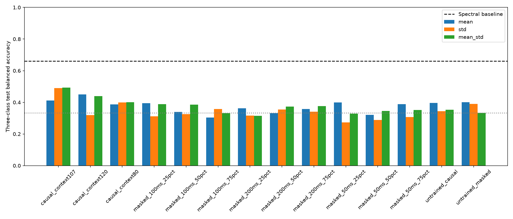

# Frozen EEG patch pooling ablation

No SSL models were retrained or selected again. All 36 trained waveform checkpoints (nine masked tasks and three causal tasks × three seeds), plus three untrained seeds for each attention rule, are evaluated on the same three-class AD/FTD/HC split. Same 52 training, 18 validation and 18 test participants, 24 windows per participant, same first-four-second unmasked EEG, original channel scaling, and frozen encoders. The existing handcrafted spectral classifier remains 66.0% balanced accuracy and is not recomputed with a different aggregation.

For each window, contextualized embeddings form an 80-patch × 32-feature matrix. Compare **mean** (32 features), **std** (32 features), and concatenated **mean + std** (64 features). Standard deviation is computed across patches independently for each embedding coordinate, with population denominator N (`unbiased=False`). Each window vector is then averaged over the same 24 windows per participant. This is the mean of within-window patch standard deviations, not a pooled standard deviation across a participant's recording; variation between windows is not added. These are embedding statistics, not raw-voltage features.

Every readout fits its own StandardScaler on training participants only and the identical fixed C=1 logistic regression, without tuning or test-based threshold/checkpoint selection. Mean+std doubles feature dimension and classifier coefficients; std-only is included as a same-dimensional diagnostic. A gain would reflect readout/pooling changes, not an improvement in the frozen encoder. C remains fixed, so effective regularization can change with the feature set. The original mean features and scores are checked against the saved study artifacts.

## Test balanced accuracy

Averages across three paired seeds. Full macro-F1 and seed SDs are in the summary CSV. Positive differences favor mean+std.

| model | mean | mean_std | std | mean_std_minus_mean |
|---|---|---|---|---|
| causal_context107 | 0.4116 | 0.4931 | 0.4894 | 0.0815 |
| causal_context120 | 0.4497 | 0.4392 | 0.3196 | -0.0106 |
| causal_context80 | 0.3868 | 0.4016 | 0.3989 | 0.0148 |
| masked_100ms_25pct | 0.3947 | 0.3878 | 0.3122 | -0.0069 |
| masked_100ms_50pct | 0.3386 | 0.3857 | 0.3254 | 0.0471 |
| masked_100ms_75pct | 0.3042 | 0.3317 | 0.3571 | 0.0275 |
| masked_200ms_25pct | 0.3624 | 0.3148 | 0.3159 | -0.0476 |
| masked_200ms_50pct | 0.3317 | 0.3725 | 0.3540 | 0.0407 |
| masked_200ms_75pct | 0.3571 | 0.3757 | 0.3413 | 0.0185 |
| masked_50ms_25pct | 0.3989 | 0.3291 | 0.2725 | -0.0698 |
| masked_50ms_50pct | 0.3212 | 0.3450 | 0.2884 | 0.0238 |
| masked_50ms_75pct | 0.3884 | 0.3513 | 0.3069 | -0.0370 |
| untrained_causal | 0.3958 | 0.3529 | 0.3434 | -0.0429 |
| untrained_masked | 0.4016 | 0.3333 | 0.3899 | -0.0683 |

[Detailed scores](eeg_pooling_assets/scores.csv), [summary with seed SD and macro-F1](eeg_pooling_assets/summary.csv), [paired seed changes](eeg_pooling_assets/paired_changes.csv), and [participant uncertainty](eeg_pooling_assets/participant_uncertainty.csv). The latter gives paired 95% percentile intervals from 5,000 diagnosis-stratified participant resamples, conditional on the fixed trained models/split. They are not training-cohort uncertainty or multiple-comparison-adjusted confirmation.

The approximately-2:1 causal model shows the largest point-estimate gain: 41.2% mean, 48.9% std-only, and 49.3% mean+std. Its conditional paired participant interval for mean+std minus mean is approximately +0.6 to +15.8 percentage points. This is exploratory and unadjusted across fourteen model/control comparisons, so it is not independent confirmation. The 3:1 causal model changes from 45.0% to 43.9%, and masked effects range from gains of about 4.7 points to losses of about 7.0 points. Pooling therefore affects individual results but is not a consistent solution. The 66.0% spectral reference remains stronger than every pooled learned mean result in this study.

One repeatedly inspected 18-person test set makes this exploratory. Standard deviation can include position/context effects as well as EEG variation; it does not establish direct preservation of spectral information. Untrained controls help distinguish generic embedding information from SSL gains. Mask ratios/spans describe pretraining only; classifier inputs are unmasked and identical. All original experiments and checkpoints are preserved.

Reproduce/resume: `CUBLAS_WORKSPACE_CONFIG=:4096:8 OPENBLAS_NUM_THREADS=1 .venv-gpu/bin/python -m temporal_ssl.eeg_pooling`.
