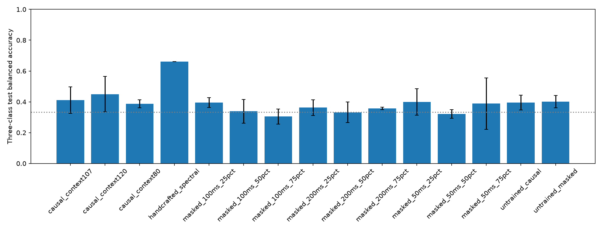
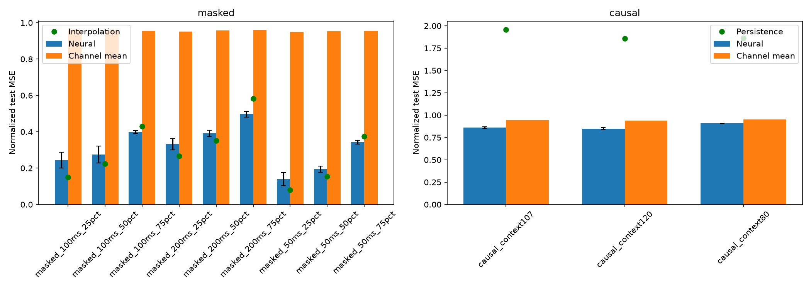
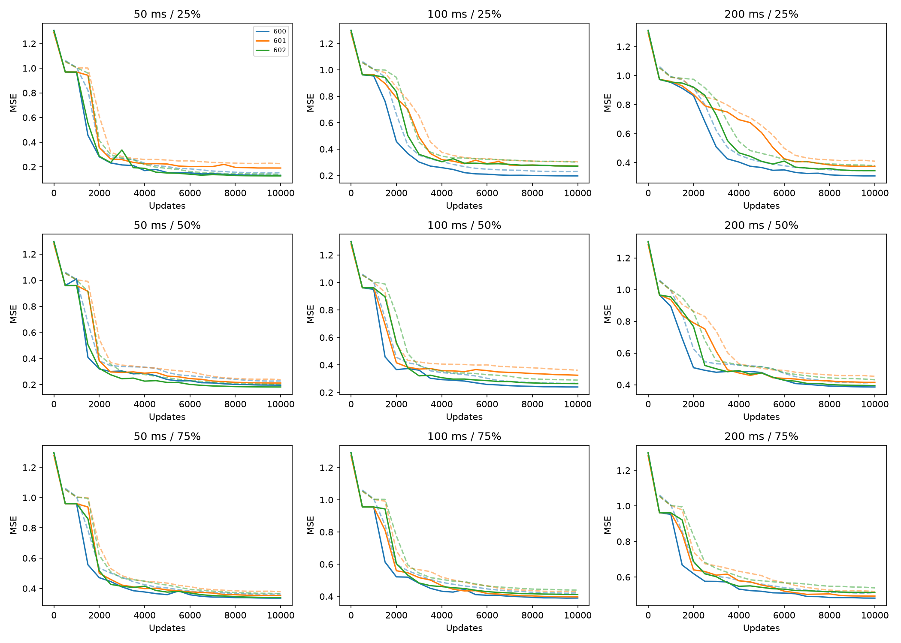
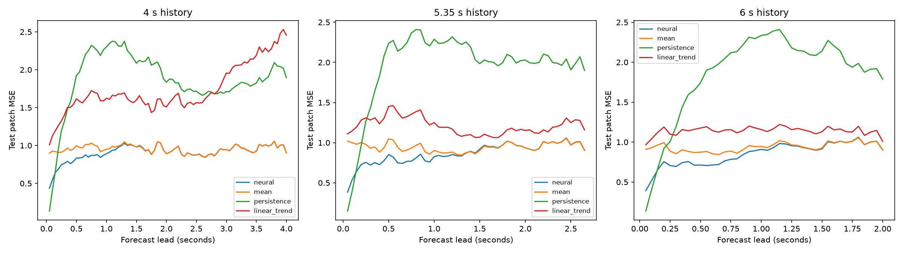
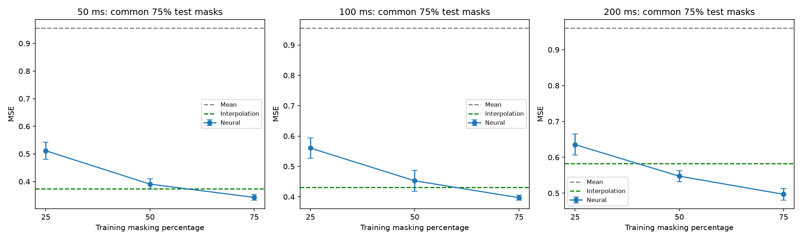

# Extended central EEG waveform baseline

Three-class AD/FTD/HC classification. Nine masked tasks (requested spans 50/100/200 ms × 25/50/75%) and three causal tasks (1:1, approximately 2:1, exact 3:1), three paired seeds each. **36 trained models total**: 24 compatible previous runs reused and 12 new runs (three causal, nine masked). Previous artifacts and binary results are preserved.

## Matched protocol

All 4,894 usable eight-second windows from the same 52 training participants; original 18/18 validation/test participants and 24-window evaluation panels. Same 19 channels/500 Hz, preprocessing/QC, original training-only channel scaling, 50 ms patches, width-32 two-layer/four-head encoder with 56,411 parameters, participant-balanced draws, 10,000 updates × batch 64, AdamW .001, 500-step warmup/cosine decay to .00001, weight decay .01, clip 1.0. The scaler was fitted on the original 24-window-per-training-participant panel and is held fixed across all full-data configurations, rather than silently refitted for this extension. No patch instance normalization, latent targets, architecture/readout changes or test-based tuning. Encoder selection minimizes the run's own validation reconstruction error. Budgets match examples/updates, not hidden-target counts or wall time.

Causal splits retain the full eight-second epoch: 4 s → 4 s; 5.35 s → 2.65 s (nearest 2:1 on the patch grid); and **6 s → 2 s, exactly 3:1** (120 context / 40 future patches). The 3:1 choice is fixed before evaluating results, rather than selecting 3:1 versus 4:1 using test performance. Source tokens use causal attention. Future queries contain no observations and cannot become keys/values; there is no teacher forcing/rollout. More context and shorter prediction change together, so this does not isolate context alone.

At 75% masking, exactly 120 of 160 patches (six seconds) are hidden across all channels, leaving two seconds visible. The existing visible-start block sampler and span=1 uniform subset sampler are reused. Blocks can merge/truncate; requested span is not every realized gap's length. Masked models can use visible context on both sides of gaps. Reconstructions are assessed on their own exact masks, with channel-mean and visible-sample interpolation baselines.

Every frozen classifier still observes **only the first four seconds**, without artificial masks, mean-pools patches/windows, and uses train-only StandardScaler + fixed C=1 logistic regression. Both untrained attention rules and the handcrafted spectral reference are retained. FTD is included in training and evaluation again. No new untrained masked control is needed for 75%: unmasked extraction is independent of mask ratio/span, and paired initial encoder weights are identical. All new pretraining runs finish before their test model evaluations begin.

The [mask geometry CSV](eeg_reconstruction_extended_assets/mask_geometry.csv) reports actual mean/median/maximum gap lengths for the fixed masks, including merged blocks.

## Classification

Mean and sample SD across three paired model/sampling seeds; spectral features have a single deterministic classifier. Seed SD is not independent-participant uncertainty.

| model | balanced_accuracy | ba_seed_sd | macro_f1 | f1_seed_sd |
|---|---|---|---|---|
| causal_context107 | 0.4116 | 0.0856 | 0.4108 | 0.0888 |
| causal_context120 | 0.4497 | 0.1143 | 0.4540 | 0.1176 |
| causal_context80 | 0.3868 | 0.0255 | 0.3810 | 0.0257 |
| handcrafted_spectral | 0.6603 | — | 0.6623 | — |
| masked_100ms_25pct | 0.3947 | 0.0321 | 0.3891 | 0.0238 |
| masked_100ms_50pct | 0.3386 | 0.0771 | 0.3059 | 0.0712 |
| masked_100ms_75pct | 0.3042 | 0.0485 | 0.2522 | 0.0482 |
| masked_200ms_25pct | 0.3624 | 0.0516 | 0.3184 | 0.0520 |
| masked_200ms_50pct | 0.3317 | 0.0670 | 0.2921 | 0.0440 |
| masked_200ms_75pct | 0.3571 | 0.0079 | 0.3234 | 0.0286 |
| masked_50ms_25pct | 0.3989 | 0.0861 | 0.3680 | 0.1082 |
| masked_50ms_50pct | 0.3212 | 0.0278 | 0.2800 | 0.0438 |
| masked_50ms_75pct | 0.3884 | 0.1665 | 0.3659 | 0.1847 |
| untrained_causal | 0.3958 | 0.0477 | 0.3885 | 0.0456 |
| untrained_masked | 0.4016 | 0.0401 | 0.3798 | 0.0527 |



## Reconstruction

| model | neural_mse | mse_seed_sd | mean_mse | interpolation_mse | persistence_mse | linear_trend_mse | fractional_mse_reduction_vs_mean |
|---|---|---|---|---|---|---|---|
| causal_context107 | 0.8625 | 0.0094 | 0.9453 | — | 1.9562 | 1.2085 | 0.0876 |
| causal_context120 | 0.8490 | 0.0108 | 0.9377 | — | 1.8579 | 1.1402 | 0.0946 |
| causal_context80 | 0.9067 | 0.0026 | 0.9529 | — | 1.8635 | 1.7365 | 0.0485 |
| masked_100ms_25pct | 0.2440 | 0.0429 | 0.9614 | 0.1503 | — | — | 0.7462 |
| masked_100ms_50pct | 0.2747 | 0.0466 | 0.9607 | 0.2230 | — | — | 0.7140 |
| masked_100ms_75pct | 0.3970 | 0.0083 | 0.9560 | 0.4306 | — | — | 0.5847 |
| masked_200ms_25pct | 0.3311 | 0.0315 | 0.9506 | 0.2662 | — | — | 0.6517 |
| masked_200ms_50pct | 0.3912 | 0.0171 | 0.9583 | 0.3511 | — | — | 0.5918 |
| masked_200ms_75pct | 0.4969 | 0.0164 | 0.9605 | 0.5823 | — | — | 0.4826 |
| masked_50ms_25pct | 0.1391 | 0.0360 | 0.9498 | 0.0805 | — | — | 0.8535 |
| masked_50ms_50pct | 0.1944 | 0.0169 | 0.9529 | 0.1542 | — | — | 0.7960 |
| masked_50ms_75pct | 0.3426 | 0.0101 | 0.9558 | 0.3743 | — | — | 0.6415 |




Solid curves show validation, dashed curves interval-average online training loss. Raw MSE across different tasks is **not a fair model ranking**. Hidden durations, accessible information, prediction lead and mask locations differ. Fractional reduction versus the training-channel mean contextualizes skill within each task; it is not latent-recovery R². Handcrafted spectral and untrained controls are frozen-feature classification references, not trained waveform decoders. Previous common-mask analyses and forecast-lead curves remain linked in the [earlier central report](eeg_reconstruction_study.md).





Every masked encoder is additionally tested at all three masking percentages using common per-span masks. These comparisons keep target locations and visible information fixed while changing the training ratio. [Cross-ratio reconstruction CSV](eeg_reconstruction_extended_assets/common_masks.csv) and [baselines](eeg_reconstruction_extended_assets/common_mask_baselines.csv) retain all values.

## Paired diagnosis uncertainty

| contrast | balanced_accuracy_difference | lower_95 | upper_95 |
|---|---|---|---|
| causal_context120 minus causal_context80 | 0.0630 | -0.0534 | 0.1857 |
| causal_context120 minus causal_context107 | 0.0381 | -0.1122 | 0.1910 |
| masked_50ms_75pct minus masked_50ms_50pct | 0.0672 | -0.0423 | 0.1836 |
| masked_100ms_75pct minus masked_100ms_50pct | -0.0344 | -0.1190 | 0.0503 |
| masked_200ms_75pct minus masked_200ms_50pct | 0.0254 | -0.0815 | 0.1460 |

95% percentile intervals use 5,000 paired resamples of test participants within diagnosis, retaining all seed predictions per participant. These are conditional on the fixed trained models/split, not new training-cohort uncertainty or multiple-comparison-adjusted confirmation.

## Findings

The 3:1 causal task averages MSE 0.849 versus 0.907 (1:1) and 0.862 (approximately 2:1). Its error reduction over its own channel-mean baseline is about 9.5%, compared with 4.8% and 8.8%. This changes both history and prediction horizon, so the easier task is not evidence that context alone caused the gain. Three-class balanced accuracy is 45.0% ± 11.4% across seeds, versus 38.7% ± 2.6% and 41.2% ± 8.6%. Both paired diagnosis intervals include zero.

At 75% masking, 50/100/200 ms spans average balanced accuracy 38.8% ± 16.6%, 30.4% ± 4.8%, and 35.7% ± 0.8%. Every paired 75%-minus-50% diagnosis interval includes zero. Thus this extension does not establish a consistent diagnostic benefit from 75% masking. The spectral reference remains 66.0%, untrained causal 39.6%, and untrained masked 40.2%.

Reconstruction does improve on the matching high-mask task. On common 75% masks, training at 25%/50%/75% gives MSE 0.511/0.391/0.343 for 50 ms spans, 0.560/0.453/0.397 for 100 ms, and 0.635/0.547/0.497 for 200 ms. All own-task 75% aggregates also beat linear interpolation (0.343 versus 0.374; 0.397 versus 0.431; 0.497 versus 0.582). Part of the shared-mask advantage can reflect matching the training and evaluation masking distributions. It does not establish a universally better representation or contradict the weaker diagnostic results; all cross-ratio values are retained in the CSV.

## Reproducibility and limits

One split with 18 repeatedly inspected test participants supports an exploratory baseline, not independent confirmation or a clinical claim. More windows add temporal coverage but not independent people. Offline provider preprocessing remains unchanged, so causality describes model access to supplied derivatives. Four-second feature extraction differs from eight-second training but is held constant across models. No adaptive budget extensions or classifier sweeps were performed.

```bash
CUBLAS_WORKSPACE_CONFIG=:4096:8 OPENBLAS_NUM_THREADS=1 \
  .venv-gpu/bin/python -m temporal_ssl.eeg_reconstruction_extension
```

The same configuration resumes saved optimizer/RNG states. [Per-seed classification](eeg_reconstruction_extended_assets/classification.csv), [reconstruction](eeg_reconstruction_extended_assets/reconstruction.csv), and [checkpoint provenance](eeg_reconstruction_extended_assets/checkpoint_provenance.json). All new checkpoints and detailed predictions are under `results/eeg_reconstruction_extension`. The [original central study](eeg_reconstruction_study.md) remains intact.
