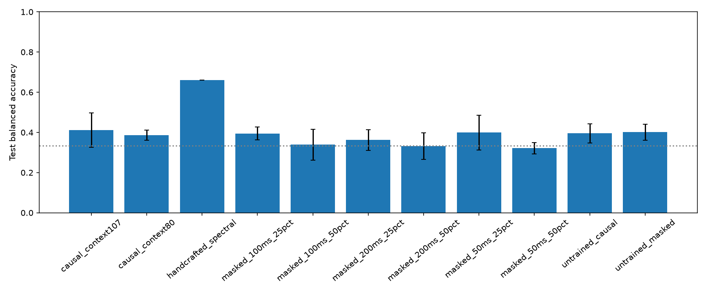
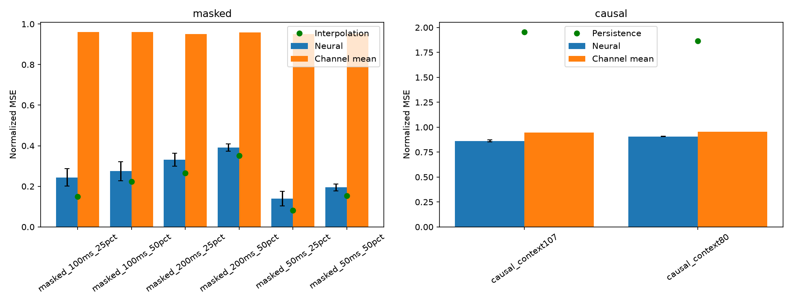
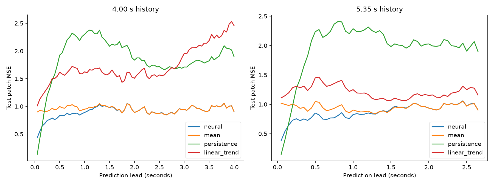

# Central EEG waveform reconstruction comparison

Latest expanded baseline: [75% masking and exact 3:1 causal task](eeg_reconstruction_extended.md). The original study is retained below.

Six masked configurations (requested spans 50/100/200 ms × 25/50% masking) and two causal forecasting tasks, three paired seeds (600–602). Full-data masked artifacts are reused after checking budget, capacity and coverage; causal models are retrained under the same full-data protocol. No latent-model results are mixed into this baseline.

## Controlled protocol

Same 52 training participants and all 4,894 usable eight-second windows; 18 validation and 18 test participants with the original 24-window panels. Same native 500 Hz/19 channels, preprocessing/QC, 25-sample patches, original training-only normalization, width-32 two-layer/four-head Transformer and linear waveform head (56,411 parameters). Same participant-balanced sampling, 10,000 updates × 64 windows = 640,000 draws, seed pairing, AdamW .001, 500-step warmup/cosine decay to .00001, weight decay .01 and clip 1.0. Checkpoints minimize their own validation reconstruction loss, never test or diagnostic labels. Matched examples/updates, not matched training wall time or number of loss-scored samples.

Causal tasks directly predict all remaining patches from the prefix, with no rollout or teacher forcing. Future tokens are position-only queries and never keys/values. **1:1:** 80 context patches / 80 target patches = 4 s → 4 s. **Approximately 2:1:** 107 / 53 patches = 5.35 s → 2.65 s (ratio 2.019:1). Exact 2:1 is impossible with 160 indivisible patches; this rounding retains the same eight-second windows and patch size. All 107 observed patches are genuinely available at training/prediction; no hidden future values enter the encoder. Masked tasks retain their existing visible-key-only bidirectional access and exact mask counts; blocks can merge/truncate.

**Frozen diagnosis observations are identical for every method:** first four seconds only, no masking, then mean patch and participant pooling. Causal locals use causal attention within that prefix; masked locals are bidirectional. Classifier is the fixed training-only StandardScaler + C=1 logistic regression. Untrained controls match each attention rule and paired initialization. Both causal splits have identical initial features on that common four-second prefix, so one untrained causal control is reported. The handcrafted spectral classifier uses the same four-second windows, participant pooling and split. It is a classification reference, not a waveform decoder. Untrained reconstruction is not compared to a trained readout; its frozen classification isolates representation changes.

## Frozen dementia classification

Mean and sample SD across three model/sampling seeds. These SDs are not independent-participant confidence intervals. Handcrafted spectral results are deterministic and have no seed SD.

| model | balanced_accuracy | ba_seed_sd | macro_f1 | f1_seed_sd |
|---|---|---|---|---|
| causal_context107 | 0.4116 | 0.0856 | 0.4108 | 0.0888 |
| causal_context80 | 0.3868 | 0.0255 | 0.3810 | 0.0257 |
| handcrafted_spectral | 0.6603 | — | 0.6623 | — |
| masked_100ms_25pct | 0.3947 | 0.0321 | 0.3891 | 0.0238 |
| masked_100ms_50pct | 0.3386 | 0.0771 | 0.3059 | 0.0712 |
| masked_200ms_25pct | 0.3624 | 0.0516 | 0.3184 | 0.0520 |
| masked_200ms_50pct | 0.3317 | 0.0670 | 0.2921 | 0.0440 |
| masked_50ms_25pct | 0.3989 | 0.0861 | 0.3680 | 0.1082 |
| masked_50ms_50pct | 0.3212 | 0.0278 | 0.2800 | 0.0438 |
| untrained_causal | 0.3958 | 0.0477 | 0.3885 | 0.0456 |
| untrained_masked | 0.4016 | 0.0401 | 0.3798 | 0.0527 |



## Waveform reconstruction

Each row uses its own hidden region/information access. **Do not rank causal versus masked methods by raw MSE**: masked models see both sides of gaps, whereas causal models forecast uncertain future waveforms. Changing a causal split changes both available history and target duration. Even masked rows with different spans/ratios have different targets. Mean/persistence/trend/interpolation are evaluated on exactly that row's targets, using only permitted observations. MSE first averages windows per participant, then participants, then seeds. No normalized patch-target losses are mixed in.

| model | neural_mse | mse_seed_sd | mean_mse | interpolation_mse | persistence_mse | linear_trend_mse | fractional_mse_reduction_vs_mean |
|---|---|---|---|---|---|---|---|
| causal_context107 | 0.8625 | 0.0094 | 0.9453 | — | 1.9562 | 1.2085 | 0.0876 |
| causal_context80 | 0.9067 | 0.0026 | 0.9529 | — | 1.8635 | 1.7365 | 0.0485 |
| masked_100ms_25pct | 0.2440 | 0.0429 | 0.9614 | 0.1503 | — | — | 0.7462 |
| masked_100ms_50pct | 0.2747 | 0.0466 | 0.9607 | 0.2230 | — | — | 0.7140 |
| masked_200ms_25pct | 0.3311 | 0.0315 | 0.9506 | 0.2662 | — | — | 0.6517 |
| masked_200ms_50pct | 0.3912 | 0.0171 | 0.9583 | 0.3511 | — | — | 0.5918 |
| masked_50ms_25pct | 0.1391 | 0.0360 | 0.9498 | 0.0805 | — | — | 0.8535 |
| masked_50ms_50pct | 0.1944 | 0.0169 | 0.9529 | 0.1542 | — | — | 0.7960 |



The existing matched-mask/cross-span reconstruction analyses remain under `results/eeg_factorial` and `results/eeg_span_study`. Per-window causal errors are saved here. Causal persistence repeats the last observed sample; trend extrapolates a least-squares line fitted only to the permitted history. Channel-mean predictions use zero under the common training normalization.



The neural curves approach the channel-mean baseline at longer forecast leads; much of the advantage is near the start. Persistence is stronger on the very earliest samples but deteriorates quickly. The horizon curves average patch errors across the same 18 × 24 test windows (equal window counts make this equal to participant averaging), then average paired seeds for neural models. Each lead is relative to its own context endpoint. They expose short-horizon behavior hidden by averaging several seconds of forecasts. [Horizon CSV](eeg_reconstruction_study_assets/causal_horizons.csv).

The fractional MSE reduction column is `1 - neural_MSE / channel_mean_MSE`, not latent recovery R². It contextualizes skill within each task and does not make different forecasting/masking tasks equivalent.

## Findings

The approximately-2:1 causal task has lower test error (0.862 versus 0.907) and a larger fractional reduction versus its own channel-mean baseline (8.8% versus 4.8%). It has both more context and a shorter forecast, so this is an easier-task comparison rather than an isolated context effect. Causal predictions still offer modest improvements over mean prediction when averaged across multi-second targets.

Diagnosis balanced accuracy averages 41.2% for approximately 2:1 and 38.7% for 1:1. The paired, diagnosis-stratified participant bootstrap gives a 2.5 percentage-point difference with a 95% percentile interval of roughly -13.8 to +18.9 points. This is not a reliable diagnosis improvement; the interval is conditional on these fixed trained models and this split, averaging the three seeds. [Uncertainty CSV](eeg_reconstruction_study_assets/causal_ratio_uncertainty.csv).

Masked neural errors increase with gap difficulty; interpolation remains better than the neural decoder in every own-task aggregate. Masked diagnosis accuracy ranges from 32.1% to 39.9%, while untrained masked features average 40.2%. Untrained causal features average 39.6%. The direct spectral classifier remains strongest at 66.0%. Neither lower reconstruction error nor the causal ratio point estimate establishes better diagnostic representations.

## Limits and reproducibility

One existing participant split, three seeds and 18 repeatedly inspected test participants support an exploratory baseline, not independent confirmation or a universal objective ranking. More windows do not add independent participants. Provider offline EEG processing can mix time information within recordings; model causality applies to supplied derivatives. First-four-second feature extraction differs from eight-second SSL training, equally documented across methods. No changes were chosen using new test results. Larger context/shorter horizon is a different forecasting task, not an isolated demonstration that context alone improves prediction.

```bash
CUBLAS_WORKSPACE_CONFIG=:4096:8 OPENBLAS_NUM_THREADS=1 \
  .venv-gpu/bin/python -m temporal_ssl.eeg_reconstruction_study
```

Identical configurations resume optimizer/sampling/Torch/CUDA RNG state. Old artifacts are preserved. [Classification CSV](eeg_reconstruction_study_assets/classification.csv), [reconstruction CSV](eeg_reconstruction_study_assets/reconstruction.csv), and [checkpoint provenance](eeg_reconstruction_study_assets/checkpoint_provenance.json) are portable companions. Details and checkpoints: `results/eeg_reconstruction_study`.
