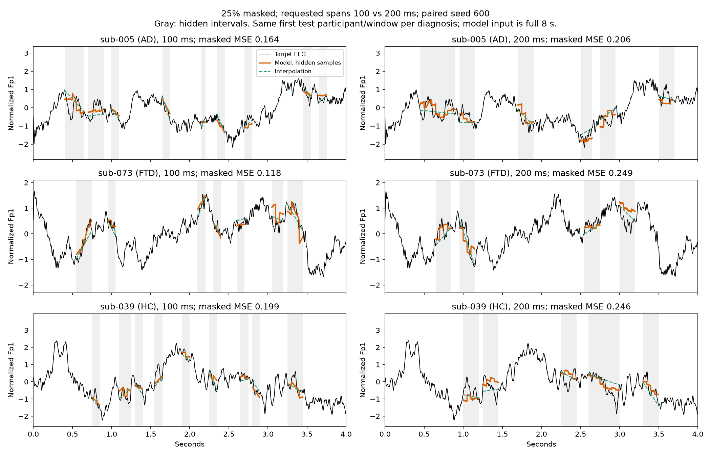
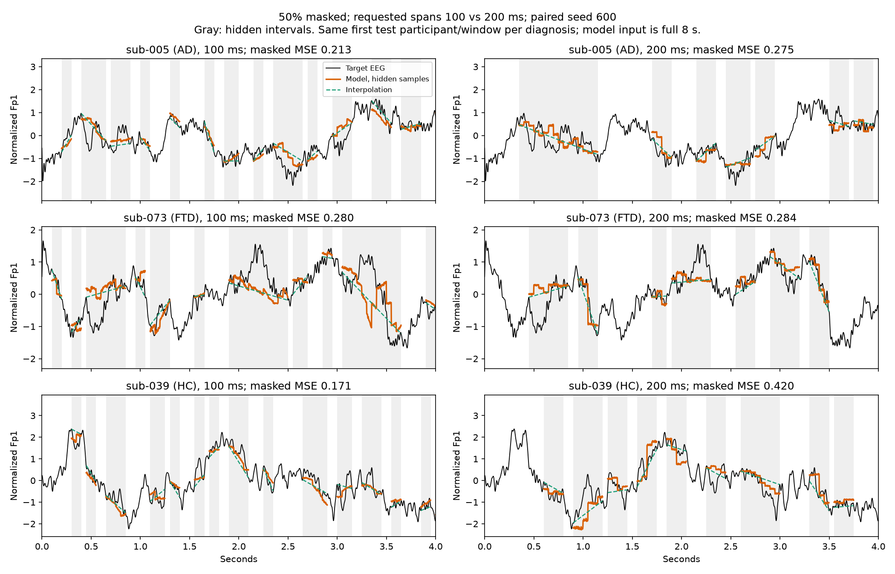

# Held-out EEG span reconstructions

Validation-selected checkpoints from the completed full-window span study, seed 600. These are **the first test participant and first cached window in each diagnosis**, selected deterministically without inspecting errors. Every model receives the full eight-second window with its original fixed evaluation masks. Panels display Fp1 over the first four seconds, with separate first-two-second enlargements. Gray intervals are hidden across all 19 channels. Orange predictions and green interpolation are drawn only inside hidden regions; black is the target. Units are the original fixed training-channel normalization, not per-patch normalization. Titles report masked MSE across all 19 channels and all eight seconds, checked against saved study scores.

## 25% masking

[Enlarge first two seconds](eeg_span_reconstruction_assets/mask25_zoom.png).

## 50% masking

[Enlarge first two seconds](eeg_span_reconstruction_assets/mask50_zoom.png).

Columns vary requested span; actual gaps can merge or truncate. Masks are therefore different across span conditions. The same subject/windows and seed are used throughout, but these panels compare different missing samples. Visual examples are not population performance estimates. [All example metrics](eeg_span_reconstruction_assets/examples.csv). Exact inputs, predictions, interpolation, masks and source identities are in `results/eeg_span_study/reconstruction_examples`. No models were trained or modified.

Reproduce: `.venv-gpu/bin/python -m temporal_ssl.eeg_span_examples --seed 600`.
