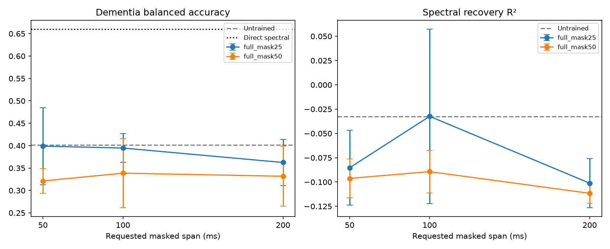
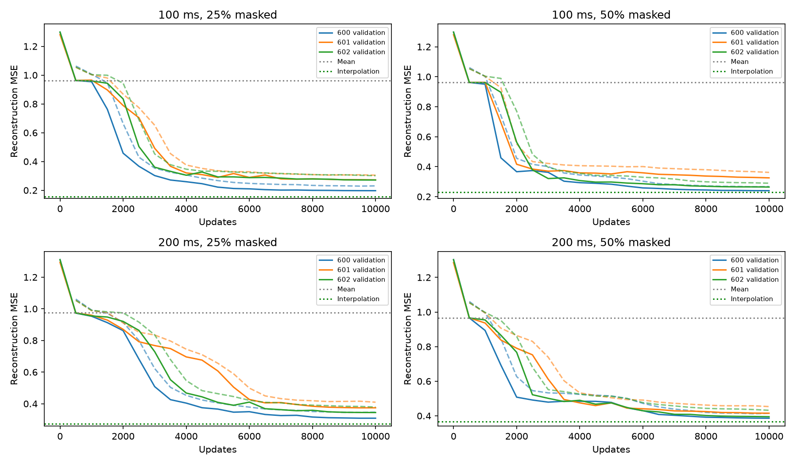
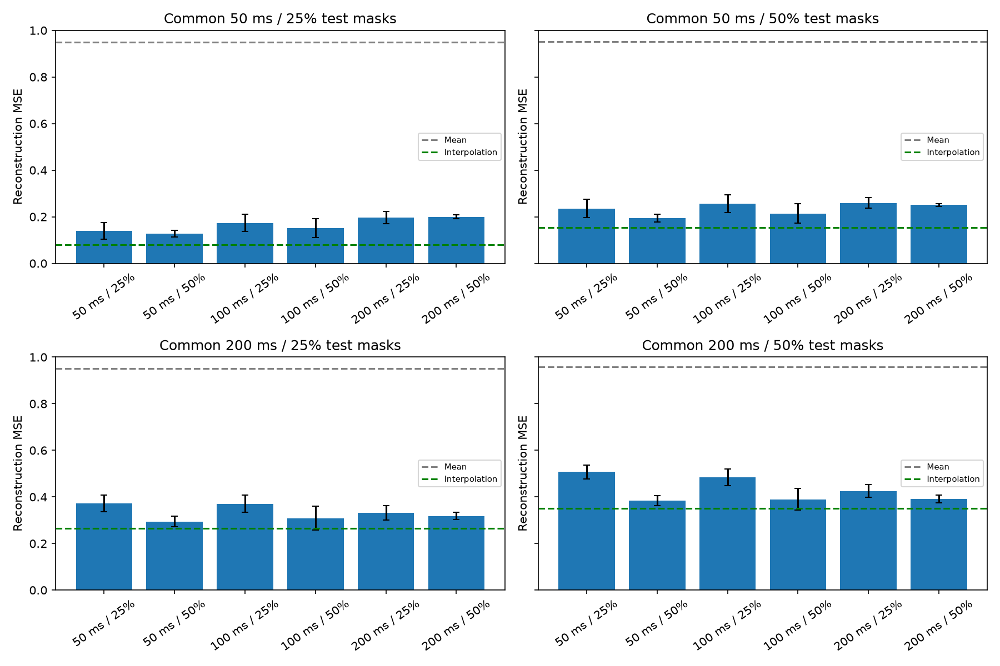

# EEG masked-span study

All usable training windows; requested spans **50, 100 and 200 ms**, crossed with **25% and 50% masking**. Patch size remains 50 ms. The 50 ms reference reuses the completed factorial study; 100/200 ms add twelve new runs (four conditions × paired seeds 600–602). No changes to data, architecture, normalization, batch size, 10,000-update budget, optimizer schedule, probe definitions or participant split. Each model receives 640,000 participant-balanced window draws and must visit all 4,894 usable training windows. Downstream probes retain the matched original 24-window panels and first-four-second observations.

Masked spans contain two/four consecutive patches; start positions are sampled uniformly among visible patches, with exact hidden counts of 40/80 out of 160. Blocks can merge or truncate; longer requested spans are not guarantees about every realized gap. The vectorized span sampler follows the previous visible-start/block-fill distribution, with new RNG realizations. It is identical to the original uniform-subset sampler at span=1. Hidden values are excluded before embedding and cannot become attention keys. Mean and visible-sample interpolation baselines use the exact scored masks. Reconstruction across different spans is a different task and should not be ranked directly.

All twelve new models finish training before test model evaluation begins. Validation checkpoint selection uses each condition's own fixed masking task, every 500 updates. Frozen logistic classifiers and train-scaled, validation-selected ridge spectral probes match the completed study. Neither test performance nor downstream validation labels select encoder checkpoints. Negative R² is retained.

## Realized gaps

| requested_span_ms | ratio | median_ms | mean_ms | max_ms | minimum_ms |
|---|---|---|---|---|---|
| 50 | 0.2500 | 50.0000 | 66.4564 | 350 | 50 |
| 50 | 0.5000 | 100.0000 | 99.1053 | 650 | 50 |
| 100 | 0.2500 | 100.0000 | 118.2104 | 500 | 50 |
| 100 | 0.5000 | 100.0000 | 154.9637 | 900 | 50 |
| 200 | 0.2500 | 200.0000 | 215.9460 | 700 | 50 |
| 200 | 0.5000 | 200.0000 | 264.3414 | 1350 | 50 |

Gap statistics describe the fixed evaluation masks; starts can merge or truncate, so these are requested span comparisons rather than fixed-length-gap comparisons.

## Test results

Mean and sample SD over three paired seeds; SD is training/sampling variability conditional on the fixed split, not participant confidence intervals.

| span_ms | condition | mean_ba | std_ba | mean_r2 | std_r2 |
|---|---|---|---|---|---|
| 50 | full_mask25 | 0.3989 | 0.0861 | -0.0854 | 0.0385 |
| 50 | full_mask50 | 0.3212 | 0.0278 | -0.0963 | 0.0200 |
| 100 | full_mask25 | 0.3947 | 0.0321 | -0.0324 | 0.0898 |
| 100 | full_mask50 | 0.3386 | 0.0771 | -0.0893 | 0.0218 |
| 200 | full_mask25 | 0.3624 | 0.0516 | -0.1012 | 0.0252 |
| 200 | full_mask50 | 0.3317 | 0.0670 | -0.1116 | 0.0102 |




Solid lines show fixed-mask validation, dashed lines interval-average online training loss. CSVs include [per-seed classification](eeg_span_study_assets/classification.csv), [spectral recovery](eeg_span_study_assets/spectral.csv), and [paired changes relative to 50 ms](eeg_span_study_assets/paired_changes.csv). Per-condition reconstruction scores, exact masks and interpolation baselines are in the results directories.

This tests whether longer missing intervals improve diagnosis or spectral representations; reconstruction alone cannot establish an interpolation shortcut or prove useful representations. The models retain the same small bottleneck and pooling/readout. One split with 18 reused test participants limits conclusions; expanded windows are from the same 52 training participants. This is exploratory, not independent confirmation or a general optimum for masking duration.



## Interpretation

- At 25% masking, mean balanced accuracy is 50 ms: 39.9%, 100 ms: 39.5%, 200 ms: 36.2%.
- At 50% masking, mean balanced accuracy is 50 ms: 32.1%, 100 ms: 33.9%, 200 ms: 33.2%.
- At 100 ms / 25%, overall spectral R² averages -0.032 (seed SD 0.090); this is closer to the untrained reference, but remains negative and variable.
- All four paired participant intervals for diagnosis changes relative to 50 ms include zero. This study does not establish a reliable span benefit.
- Longer gaps can change reconstruction skill without making the mean-pooled features better for diagnosis. These results do not prove the network uses interpolation, or establish that useful information is absent nonlinearly.

## Paired participant uncertainty

| ratio | span_ms | difference_vs_50ms | lower_95 | upper_95 |
|---|---|---|---|---|
| 25 | 100 | -0.0042 | -0.1212 | 0.1249 |
| 25 | 200 | -0.0365 | -0.1275 | 0.0481 |
| 50 | 100 | 0.0175 | -0.0603 | 0.1075 |
| 50 | 200 | 0.0106 | -0.0926 | 0.1243 |

Paired participant-bootstrap intervals (5,000 resamples within diagnosis, preserving all seed predictions for each person) are saved in [participant uncertainty](eeg_span_study_assets/participant_bootstrap.csv). They are conditional on the fixed trained models and split, and do not capture new training-cohort uncertainty. All span models are additionally scored on identical 50 ms and 200 ms masks at both ratios: [common reconstruction](eeg_span_study_assets/common_reconstruction.csv) and [baselines](eeg_span_study_assets/common_reconstruction_baselines.csv). Those are comparisons of model ability on matched reconstruction tasks, unlike comparing each model's own-span loss.

## Reproduce

```bash
CUBLAS_WORKSPACE_CONFIG=:4096:8 OPENBLAS_NUM_THREADS=1 \
  .venv-gpu/bin/python -m temporal_ssl.eeg_span_study
```

The command resumes identical configurations, preserving optimizer and sampling/masking/Torch/CUDA states. Config, source hashes, exact window identities, coverage counts, checkpoints, predictions, fitted probe scalers and validation scores are saved under `results/eeg_span_study`. Earlier results and original course files are preserved.
