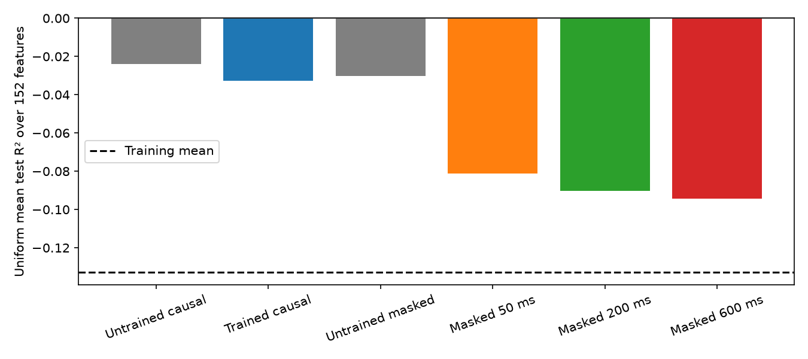
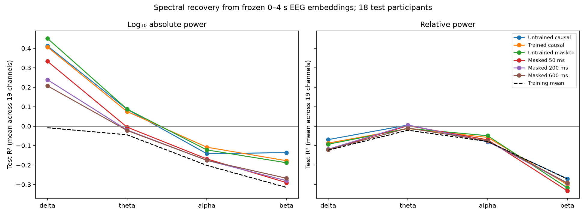

# EEG spectral information recoverability

Can the frozen pilot encoders linearly recover the spectral information used by the stronger dementia classifier? The hypothesis was that pretraining would improve accessibility, with an effect of masking duration. This is a diagnostic of existing checkpoints, with no SSL retraining, new preprocessing, or downloads.

## Protocol

OpenNeuro ds004504 v1.0.9: 88 participants, 52 train / 18 validation / 18 test, using the original diagnosis-stratified, participant-disjoint split (seed 600). There are 24 cached epochs per participant. Every encoder and spectral target uses the same first 4 s (2,000 samples at 500 Hz) of each native 8 s epoch. Masked encoders receive no artificial masks. Each 50 ms patch yields 32 features; mean-pool 80 patch embeddings, then mean-pool 24 windows per participant. Targets are likewise the mean of epoch features, not features of an averaged waveform.

The exact earlier spectral baseline supplies **152 targets**: 19 channels × delta (1–4 Hz), theta (4–8 Hz), alpha (8–13 Hz), beta (13–30 Hz) × two measures. Measures are log10 absolute bandpower (power in µV², floor 1e-12 µV²) and relative power (bandpower divided by 1–30 Hz power). Welch uses 2 s Hann segments, 50% overlap, constant detrending, and native 0.5 Hz bins; integration interpolates band endpoints and uses trapezoids. No gamma targets. Relative powers sum to one per channel. Averaging log powers across windows is retained exactly from classification.

Ridge predicts all targets jointly. Input and target StandardScalers fit only the 52 training participants. Select one shared alpha per encoder from [0.001, 0.01, 0.1, 1.0, 10.0, 100.0, 1000.0, 10000.0] by highest uniform mean validation R². The final probe remains fitted on training participants only. Predictions are inverse-transformed before scoring. Compute each target's R² across the 18 test participants, then average equally across targets (38 per band, 19 per band/measure); this prevents high-variance targets dominating. Normalized MSE divides each squared error by that target's training variance. Constant or near-constant training/evaluation targets (SD ≤ 1e-12 + 1e-10 × maximum absolute training value) have undefined R² and are excluded/count-reported, never assigned perfect scores. No targets were excluded in this run. Training-mean predictions provide a separate baseline; their test R² can be negative because test means differ.

## Checkpoints and cache verification

Evaluated `causal/best.pt`, `masked_short/best.pt`, `masked_medium/best.pt`, and `masked_long/best.pt` under `results/eeg_pilot` (validation-selected epochs 20, 17, 16, 20). The two random encoders reproduce initialization seed 600 using the original model configuration. All three masked runs started with the same initial weights. Encoders were frozen throughout. Existing first-4-s participant embeddings and exact spectral targets were reused. Original extraction source hashes were checked, and each of the six encoder caches was checked by re-extracting all 24 windows of the first training participant. Every cached spectral epoch was recomputed from the matching first half of stored raw EEG (maximum discrepancy 7.8e-08, due to float32 EEG storage). Participant target means and training-only SSL normalization were verified. Checkpoint hashes, versions, probe scalers, predictions, target arrays, and validation-grid scores are saved in `results/eeg_spectral_recoverability`.

## Held-out results

| model | alpha | validation_r2 | test_r2 | normalized_mse |
|---|---|---|---|---|
| untrained_causal | 100.000 | 0.014 | -0.024 | 1.317 |
| causal | 100.000 | -0.020 | -0.033 | 1.316 |
| untrained_masked | 100.000 | -0.025 | -0.030 | 1.310 |
| masked_short | 1000.000 | -0.050 | -0.081 | 1.371 |
| masked_medium | 1000.000 | -0.065 | -0.090 | 1.383 |
| masked_long | 1000.000 | -0.058 | -0.094 | 1.388 |
| training_mean | nan | -0.076 | -0.133 | 1.424 |



Per-band R² below averages both power measures equally across all 19 channels. The figure separates the two measures.

| model | delta | theta | alpha | beta |
|---|---|---|---|---|
| untrained_causal | 0.172 | 0.046 | -0.111 | -0.203 |
| causal | 0.160 | 0.031 | -0.083 | -0.239 |
| untrained_masked | 0.179 | 0.038 | -0.086 | -0.252 |
| masked_short | 0.107 | -0.001 | -0.119 | -0.311 |
| masked_medium | 0.060 | -0.007 | -0.127 | -0.287 |
| masked_long | 0.043 | -0.016 | -0.125 | -0.279 |
| training_mean | -0.066 | -0.033 | -0.140 | -0.293 |



Trained minus corresponding untrained test R² (each probe independently validation-selected):

| model | control | delta_r2 |
|---|---|---|
| causal | untrained_causal | -0.009 |
| masked_short | untrained_masked | -0.051 |
| masked_medium | untrained_masked | -0.060 |
| masked_long | untrained_masked | -0.064 |

## Interpretation and limits

Causal pretraining changes overall R² by -0.009; the 50/200/600 ms masked changes are -0.051, -0.060, -0.064. **Pretraining did not improve overall spectral linear recoverability in any of these four comparisons.** Among trained masked checkpoints, overall recovery declines as requested mask duration increases (50 → 200 → 600 ms). These comparisons describe this seed/split and separately selected probe penalties, not a general duration effect.

All six overall scores are negative, but all beat the fitted training-mean baseline (-0.133). This indicates limited out-of-sample recovery averaged over all spectral targets, not zero recoverable content. Delta-band R² is positive in every encoder (0.043–0.179); theta is weak, and alpha/beta averages are negative. The two untrained encoders recover log absolute power better on average than relative power. Full feature scores retain positive and negative values without clipping. One explicit exception to the aggregate pretraining trend is causal alpha recovery: it improves from -0.111 to -0.083, while remaining negative.

The earlier dementia balanced accuracies were 36.8% untrained causal, 41.6% trained causal, 35.7% untrained masked, 47.1/47.9/42.4% masked 50/200/600 ms, and 66.0% with spectral features directly. **The rankings differ:** diagnosis classification improved after pretraining while overall spectral recovery declined; medium masks classified slightly better than short masks despite weaker spectral recovery. Spectral regression asks about all channel/band targets, whereas classification only needs disease-discriminative directions. The representations therefore do not provide a reliable linear reconstruction of the complete spectral baseline, but this diagnostic cannot establish spectral loss as the cause of the classification gap.

Positive R² means these observed spectral summaries are linearly accessible from participant-averaged representations on held-out participants. Negative R² means the probe performs worse than predicting each target's test-set mean; that comparator is a scoring reference, not a usable fitted baseline. Low R² does not establish information absence: nonlinear encoding and mean pooling may hide it. Targets are derived summaries of EEG, not independent dynamical ground truth. A single seed/split and 18 test participants support descriptive comparisons only. Relative-power targets are correlated and log-power units differ from fractions; uniform averaging is explicit. Provider offline preprocessing is unchanged. The optional full-epoch and epoch-level analyses were omitted to keep the matched-input diagnostic focused.

A next experiment, if needed, should target the observed weak bands or disease-relevant spectral directions with a predeclared protocol; this result alone does not justify foundation-scale pretraining. Preserve the current test split as evaluated rather than using repeated diagnostics as independent confirmation.

## Reproduce without SSL training

```bash
CUBLAS_WORKSPACE_CONFIG=:4096:8 OPENBLAS_NUM_THREADS=1 \
  .venv-gpu/bin/python -m temporal_ssl.eeg_spectral_recoverability \
  --pilot results/eeg_pilot --output results/eeg_spectral_recoverability
.venv-gpu/bin/python -m pytest -q tests/test_eeg_spectral_recoverability.py
```

CPU cache verification is available with `--device cpu`. Missing checkpoints or incompatible cache provenance stop explicitly; nothing is silently retrained. Portable tables: [overall](eeg_spectral_recoverability_assets/overall.csv), [per band](eeg_spectral_recoverability_assets/per_band.csv), [all 152 features](eeg_spectral_recoverability_assets/per_feature.csv), [paired changes](eeg_spectral_recoverability_assets/trained_minus_untrained.csv), [ridge selection](eeg_spectral_recoverability_assets/ridge_selection.csv).
