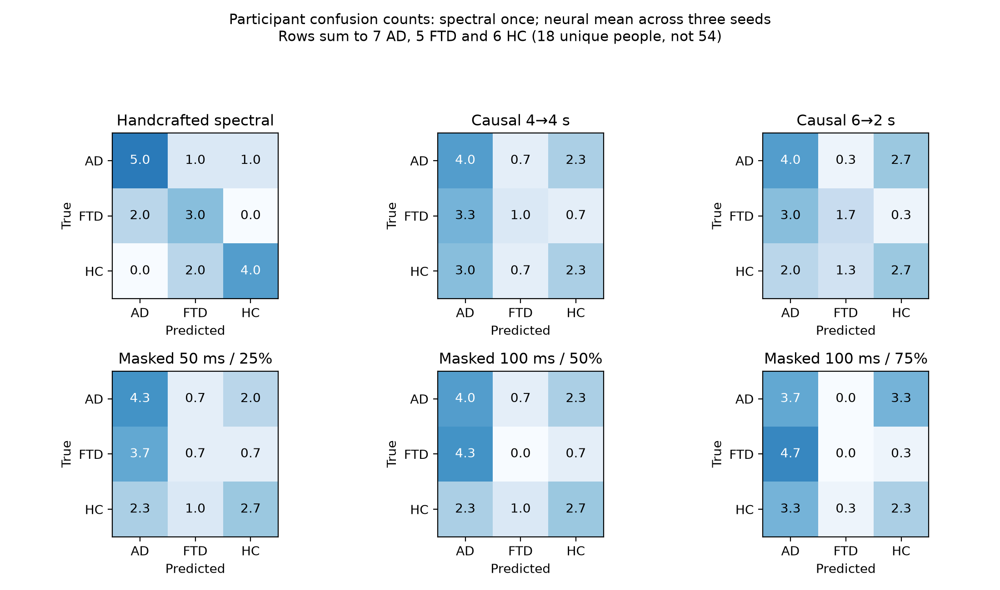

# Supplementary EEG diagnostic uncertainty and quality control

This analysis reuses the primary three-class **mean-pooled** results: 12 pretrained configurations × three matched seeds (600–602), two attention-matched untrained controls, and one deterministic handcrafted spectral classifier. There is no retraining, hyperparameter selection, new split or change to preprocessing/readouts.

## Methods and verification

The fixed test panel contains **18 unique participants: 7 AD, 5 FTD and 6 HC**. The original split has 52 training and 18 validation participants. Frozen neural features use the same first four seconds of each of 24 selected windows, with mean pooling over patches and then windows per participant. The saved training-only scaler and fixed C=1 logistic classifier are retained. Validation predictions are audited but do not enter the confidence intervals.

Saved predictions from all 43 fitted readouts (36 pretrained, six untrained and one spectral) were checked against predictions from their existing classifiers and saved participant features, their confusion matrices, and saved metrics. All participant IDs/labels match the original split. All 36 trained checkpoint hashes were verified, and each saved initialization exactly matches its attention/seed control. Test means and seed SDs agree with the extended central report and the mean-pooling ablation to absolute tolerance 1e-12. No discrepancies were found.

For each of 5,000 bootstrap replicates, sample 7 AD, 5 FTD and 6 HC participants with replacement within diagnosis, using **the same sampled participant indices for every model and seed**. Compute balanced accuracy separately per model/seed, subtract its matched control, then average the three seed-specific differences. Report percentile 2.5th/97.5th bounds. The spectral baseline is subtracted once per pretrained seed but is the same deterministic prediction vector, not three independently fitted baselines. RNG seed: 5600.

These exploratory intervals quantify **test-cohort sampling uncertainty conditional on the fitted models, probes and existing split**. They do not resample training participants or training runs. Sample SD across the three paired seed differences is reported separately; it is not a confidence interval. No multiplicity correction is applied.

## Paired balanced accuracy differences

All entries below use percentage points (pp) for differences and interval limits. BA columns are percentages averaged across seeds. The final column is the sample SD of the three paired seed differences, also in pp.

| Pretrained configuration | Reference | BA | Ref. BA | Δ BA (pp) | Paired 95% interval (pp) | Seed SD of Δ (pp) |
|---|---|---:|---:|---:|---:|---:|
| Causal 5.35→2.65 s | Untrained causal | 41.2 | 39.6 | +1.6 | [-9.3, +12.7] | 9.3 |
| Causal 6→2 s | Untrained causal | 45.0 | 39.6 | +5.4 | [-6.1, +16.6] | 9.0 |
| Causal 4→4 s | Untrained causal | 38.7 | 39.6 | -0.9 | [-17.9, +14.3] | 6.7 |
| Masked 100 ms / 25% | Untrained masked | 39.5 | 40.2 | -0.7 | [-16.5, +15.1] | 2.8 |
| Masked 100 ms / 50% | Untrained masked | 33.9 | 40.2 | -6.3 | [-23.5, +9.8] | 4.9 |
| Masked 100 ms / 75% | Untrained masked | 30.4 | 40.2 | -9.7 | [-27.5, +6.2] | 8.9 |
| Masked 200 ms / 25% | Untrained masked | 36.2 | 40.2 | -3.9 | [-19.3, +10.6] | 8.4 |
| Masked 200 ms / 50% | Untrained masked | 33.2 | 40.2 | -7.0 | [-19.9, +5.2] | 10.2 |
| Masked 200 ms / 75% | Untrained masked | 35.7 | 40.2 | -4.4 | [-21.9, +10.6] | 3.2 |
| Masked 50 ms / 25% | Untrained masked | 39.9 | 40.2 | -0.3 | [-17.5, +16.4] | 6.4 |
| Masked 50 ms / 50% | Untrained masked | 32.1 | 40.2 | -8.0 | [-25.9, +7.7] | 5.4 |
| Masked 50 ms / 75% | Untrained masked | 38.8 | 40.2 | -1.3 | [-16.4, +13.0] | 16.3 |
| Causal 6→2 s | Handcrafted spectral | 45.0 | 66.0 | -21.1 | [-48.4, +7.1] | 11.4 |

All 12 pretrained-versus-untrained intervals include zero. The data do not resolve a diagnostic benefit from pretraining; the wide intervals also allow meaningful improvement or deterioration and do not establish equivalence.

The best mean-pooled pretrained point estimate is **Causal 6→2 s**, chosen descriptively from the already reported test means. Its difference from the spectral reference is -21.1 pp. This best-of-12 selection is post hoc; the interval does not account for selection and should not be presented as a confirmatory comparison. Neural seed SDs and every individual paired seed difference are retained in the numerical outputs.

## FTD misclassification

Counts are for the **same five true FTD participants in each seed**, ordered as predicted AD / FTD / HC. Spectral has one deterministic fit. Two additional pretrained configurations were selected descriptively by lowest mean FTD recall outside the requested examples (ties by configuration name); this is an error-analysis selection, not tuning.

| Configuration | Seed | FTD → AD | FTD → FTD | FTD → HC | FTD recall |
|---|---|---:|---:|---:|---:|
| Handcrafted spectral | single fit | 2 | 3 | 0 | 60% |
| Causal 4→4 s | 600 | 4 | 1 | 0 | 20% |
| Causal 4→4 s | 601 | 3 | 1 | 1 | 20% |
| Causal 4→4 s | 602 | 3 | 1 | 1 | 20% |
| Causal 6→2 s | 600 | 3 | 2 | 0 | 40% |
| Causal 6→2 s | 601 | 2 | 2 | 1 | 40% |
| Causal 6→2 s | 602 | 4 | 1 | 0 | 20% |
| Masked 50 ms / 25% | 600 | 5 | 0 | 0 | 0% |
| Masked 50 ms / 25% | 601 | 4 | 0 | 1 | 0% |
| Masked 50 ms / 25% | 602 | 2 | 2 | 1 | 40% |
| Masked 100 ms / 50% | 600 | 4 | 0 | 1 | 0% |
| Masked 100 ms / 50% | 601 | 5 | 0 | 0 | 0% |
| Masked 100 ms / 50% | 602 | 4 | 0 | 1 | 0% |
| Masked 100 ms / 75% | 600 | 5 | 0 | 0 | 0% |
| Masked 100 ms / 75% | 601 | 5 | 0 | 0 | 0% |
| Masked 100 ms / 75% | 602 | 4 | 0 | 1 | 0% |



Rows are true AD/FTD/HC and columns predicted AD/FTD/HC. Neural panels show **mean counts per seed**, rounded to one decimal; unrounded rows sum to 7, 5 and 6. They are not counts from 54 independent participants. Exact integer matrices for every seed and all models are in [the per-seed matrix table](eeg_supplement_assets/confusion_matrices_per_seed.csv).

| Configuration | Mean FTD → AD | Mean FTD → FTD | Mean FTD → HC | FTD recall across seeds |
|---|---:|---:|---:|---:|
| Handcrafted spectral | 2.00 | 3.00 | 0.00 | 60.0% (60–60%) |
| Causal 4→4 s | 3.33 | 1.00 | 0.67 | 20.0% (20–20%) |
| Causal 6→2 s | 3.00 | 1.67 | 0.33 | 33.3% (20–40%) |
| Masked 50 ms / 25% | 3.67 | 0.67 | 0.67 | 13.3% (0–40%) |
| Masked 100 ms / 50% | 4.33 | 0.00 | 0.67 | 0.0% (0–0%) |
| Masked 100 ms / 75% | 4.67 | 0.00 | 0.33 | 0.0% (0–0%) |

The spectral classifier labels 2 of five FTD participants as AD, 3 as FTD and 0 as HC. In each displayed neural model/seed, more FTD participants are mislabeled as AD than as HC. Causal 4→4 s recognizes one of five FTD participants in every seed; causal 6→2 s recognizes one or two; masked 50 ms/25% recognizes zero, zero and two. The additional 100 ms/50% and 100 ms/75% configurations recognize none in all three seeds. This describes the selected models on these five people; these errors cannot establish biological similarity between diseases or a general tendency in the population. One FTD participant changes FTD recall by **20 pp** and three-class balanced accuracy by **6.67 pp**. Repeated errors across seeds concern the same people, not additional independent evidence. The [participant prediction table](eeg_supplement_assets/ftd_participant_predictions.csv) preserves individual identities and seed-specific destinations.

## Verified window quality control

Both cached manifests cover all 88 participants. The full-cache manifest records rejected candidate counts, independently agrees with the capped cache, and stores the original removed-sample durations. Existing derivative metadata (`clean_sample_mask`, boundary events and sample counts) were read without altering preprocessing. The original boundary-mapping function verifies retained-sample masks against internal boundaries. Complete non-overlapping eight-second candidates are counted separately inside each retained contiguous segment; no candidate bridges a boundary.

| Quantity | Train | Validation | Test | All participants |
|---|---:|---:|---:|---:|
| Complete 8-second candidate windows | 4,894 | 1,761 | 1,809 | 8,464 |
| Usable full-cache windows | 4,894 | 1,761 | 1,809 | 8,464 |
| Nonfinite-window rejections | 0 | 0 | 0 | 0 |
| Flat-channel-window rejections | 0 | 0 | 0 | 0 |
| Total candidate-window rejections | 0 | 0 | 0 | 0 |
| Selected capped-panel windows | 1,248 | 432 | 432 | 2,112 |
| Provider-mask removed samples | 221,740 | 66,740 | 91,110 | 379,590 |
| Provider-mask removed time (s) | 443.480 | 133.480 | 182.220 | 759.180 |
| Internal recording boundaries | 300 | 92 | 120 | 512 |
| Retained contiguous segments | 352 | 110 | 138 | 600 |
| Unused segment-tail samples | 622,510 | 211,760 | 225,290 | 1,059,560 |
| Unused segment-tail time (s) | 1,245.020 | 423.520 | 450.580 | 2,119.120 |

**Zero nonfinite and zero flat-channel rejections are established**, not assumed from inspecting a selected subset: the original selection function has only those rejection causes and all 88 original rejected totals are zero. A read-only scan of every full-cache window independently confirms finite samples and no channel with peak-to-peak amplitude ≤1e-6 µV. An amplitude above 1,000 µV is a review flag only, not a rejection criterion. No participant was excluded for having zero usable windows.

Provider-mask removals occurred before candidate generation and are not nonfinite/flat-window QC rejects. Discontinuities are respected by restarting the epoch grid, rather than creating cross-boundary candidates and rejecting them. The unused tails are the residual samples shorter than eight seconds at the end of each retained segment. There is no unique number of “boundary-rejected windows” under this grid, so no such count is invented. Mask removals, segment tails and candidate QC are separate operations and should not be added as rejected windows. Mask samples document provider removal but do not identify separate ASR/ICA/filter causes, and this audit does not claim such a breakdown.

## Interpretation for the research paper

> None of the 12 mean-pooled pretrained configurations showed a resolved improvement over its matched untrained encoder under participant-paired, diagnosis-stratified 95% bootstrap intervals. The strongest pretrained point estimate, causal 6→2 s, exceeded its control by 5.4 percentage points (95% interval −6.1 to +16.6), while remaining 21.1 points below the handcrafted spectral classifier (−48.4 to +7.1). These intervals quantify test-cohort uncertainty conditional on fitted models and differ from training-seed variability. Among the displayed models, FTD errors predominantly went to AD rather than HC; only five unique FTD participants were available. All 8,464 complete candidate EEG windows passed the nonfinite and flat-channel checks; 759.18 seconds of provider-mask removals and 2,119.12 seconds of unused segment tails were separate from window QC rejection.

All comparisons remain exploratory because the small test split has been examined repeatedly, the best-model spectral contrast is selected post hoc, and confidence bounds are not adjusted across comparisons. The absence of candidate-window QC rejections does not mean the source EEG was artifact-free: supplied cleaning had already removed samples and modified recordings.

## Numerical outputs and reproduction

[Paired intervals](eeg_supplement_assets/paired_bootstrap.csv), [paired seed differences](eeg_supplement_assets/paired_seed_differences.csv), [verified original scores](eeg_supplement_assets/verified_scores.csv), [FTD counts](eeg_supplement_assets/ftd_counts_per_seed.csv), [QC by participant](eeg_supplement_assets/qc_by_participant.csv), [QC totals](eeg_supplement_assets/qc_totals.csv), and [source/checkpoint audit](eeg_supplement_assets/audit.json). All saved source predictions are copied into the numerical outputs for traceability.

```bash
OPENBLAS_NUM_THREADS=1 .venv-gpu/bin/python -m temporal_ssl.eeg_supplement
```

Implementation: `temporal_ssl/eeg_supplement.py`; complete numerical outputs and exact bootstrap samples: `results/eeg_supplement/`. Portable CSVs, provenance and the figure accompany this report. All prior reports, splits, checkpoints, classifiers and caches are preserved.
