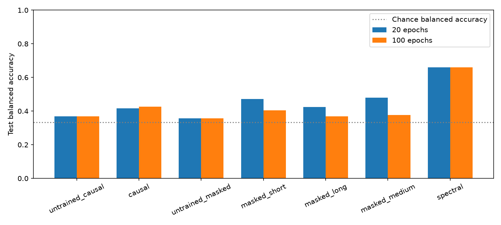
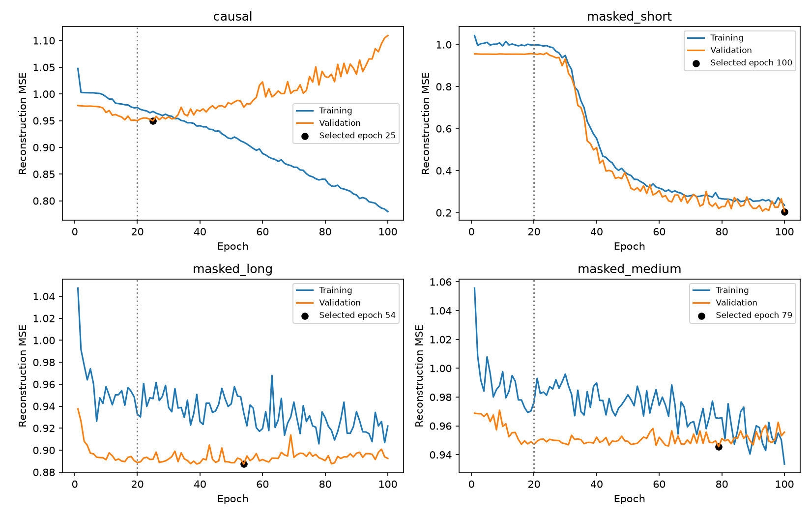
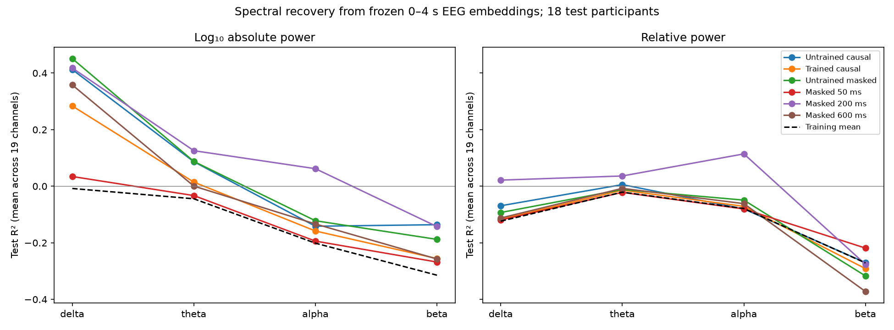

# EEG objective comparison at 100 epochs

All four original objectives were continued to **100 total epochs (7,800 optimizer updates each)**. The completed 100-epoch short-mask checkpoint was reused. All model, AdamW, shuffle/mask/Torch/CUDA RNG states were restored from the saved continuation checkpoints. Architecture, learning rate, batch size, preprocessing, normalization, seed 600, and participant splits remain unchanged. Checkpoints are selected by lowest validation reconstruction loss over epochs 1–100. There is no test-based tuning or classifier hyperparameter sweep.

The original split contains 52 train / 18 validation / 18 test participants, with 24 eight-second windows per participant. SSL uses full eight-second windows under each objective's access rules. Every frozen classification and spectral probe uses only the first four seconds, mean-pooling patch embeddings and then windows per participant. Classification uses the original training-only standardization and fixed logistic regression. Spectral recovery uses the same 152 Welch features, training-only input/target scaling, and validation-selected ridge grid. Original 20-epoch artifacts remain in `results/eeg_pilot`; new artifacts are in `results/eeg_pilot_100`. Spectral probe artifacts are in `results/eeg_spectral_recoverability_100`.

## Dementia classification

| model | ba_20 | ba_100 | f1_20 | f1_100 |
|---|---|---|---|---|
| untrained_causal | 0.368 | 0.368 | 0.363 | 0.363 |
| causal | 0.416 | 0.427 | 0.402 | 0.408 |
| untrained_masked | 0.357 | 0.357 | 0.332 | 0.332 |
| masked_short | 0.471 | 0.405 | 0.458 | 0.348 |
| masked_long | 0.424 | 0.368 | 0.417 | 0.361 |
| masked_medium | 0.479 | 0.376 | 0.468 | 0.371 |
| spectral | 0.660 | 0.660 | 0.662 | 0.662 |



## Reconstruction at validation-selected checkpoints

| model | selected_epoch | validation_mse | test_neural_mse | test_mean_mse |
|---|---|---|---|---|
| causal | 25 | 0.950 | 0.930 | 0.953 |
| masked_short | 100 | 0.205 | 0.195 | 0.958 |
| masked_long | 54 | 0.887 | 0.905 | 0.955 |
| masked_medium | 79 | 0.946 | 0.942 | 0.961 |

Causal and masked errors score different tasks and should not be ranked directly. Masked interpolation baselines and exact test masks are saved in each model directory. Reconstruction improvement does not guarantee better frozen classification.



## Linear spectral recovery

Uniform mean test R² across 152 features in original target units; negative scores are retained. Each training duration has its own validation-selected ridge penalty.

| model | test_r2_20 | test_r2_100 | alpha |
|---|---|---|---|
| untrained_causal | -0.024 | -0.024 | 100.000 |
| causal | -0.033 | -0.076 | 1000.000 |
| untrained_masked | -0.030 | -0.030 | 100.000 |
| masked_short | -0.081 | -0.113 | 1000.000 |
| masked_medium | -0.090 | 0.045 | 100.000 |
| masked_long | -0.094 | -0.073 | 100.000 |
| training_mean | -0.133 | -0.133 | nan |



## Interpretation limits

Short-mask reconstruction test MSE changes from 0.956 to 0.195, while its dementia balanced accuracy changes from 47.1% to 40.5%. Its overall spectral R² changes from -0.081 to -0.113. These measured changes should be interpreted separately; waveform reconstruction is not a surrogate for diagnosis accuracy or complete spectral preservation.

These are exploratory one-seed comparisons on the existing test set, which has already been examined. They are not independent confirmation or evidence of a general objective ranking. Differences on 18 test participants are descriptive. Longer training changes learned representations; reconstruction, diagnosis classification, and linear spectral recovery measure different properties. The original untrained and direct spectral controls use unchanged observations and fitting protocols. No new architecture, EEG preprocessing, data download, or additional tuning sweep was introduced.

## Reproduce

```bash
CUBLAS_WORKSPACE_CONFIG=:4096:8 OPENBLAS_NUM_THREADS=1 \
  .venv-gpu/bin/python -m temporal_ssl.eeg_sweep_100
# Add --resume only to continue an interrupted run in the same output directory.
```

CSV tables and plots are alongside this report under `eeg_sweep_100_assets/`; detailed checkpoint hashes, probe scalers, predictions and validation scores remain in the results directories.
