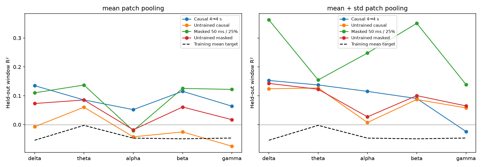

# Window-level five-band spectral recoverability

Existing frozen waveform encoders contain modest linearly accessible spectral information. The clearest result in this seed is the masked model with mean+std patch pooling: average test R² **0.251**, versus **0.092** for its untrained control. Mean pooling alone gives 0.095 versus 0.044. These are spectral regression results, not dementia classification scores.



## Protocol

- No SSL training. Saved seed-600 best reconstruction checkpoints: causal 4 s → 4 s and masked 50 ms / 25%, plus their exact saved initializations. Both controls share identical parameter values but use their respective causal/bidirectional attention.
- Original participant split: 52 train, 18 validation, 18 test, including AD, FTD and HC. Keep the same 24 evenly spaced eight-second epochs per participant; only their first four seconds are observed by both encoder and target calculation. This yields 1,248 / 432 / 432 separate windows. There is **no participant averaging** of features or targets. Pretrained models themselves used all eligible training windows under the earlier full-data protocol.
- Targets are Welch relative powers calculated from cached physical µV EEG before global normalization. These recordings are already cleaned derivatives, previously filtered at 0.5–45 Hz. Use 2-second Hann segments, 50% overlap, constant detrending, native 500 Hz sampling and trapezoidal integration with interpolated band endpoints. Delta 1–4, theta 4–8, alpha 8–13, beta 13–30, gamma **30–45 Hz**. For each channel divide band power by its 1–45 Hz power, then average the 19 channel fractions equally. Five fractions sum to one, so they are dependent targets. Gamma is restricted by the available preprocessing; this does not measure full gamma.
- Frozen encoders receive the same first 2,000 samples, normalized with the unchanged saved training-only channel mean/std. Unmasked extraction produces 80 patch embeddings. Primary pooling: mean across patches (32 dimensions). Secondary check: concatenate mean and population standard deviation across patches (64 dimensions), still one vector per window.
- Fit input and target StandardScalers using training windows only, then multi-output ridge with one shared alpha. Choose alpha from 0.001, 0.01, 0.1, 1, 10, 100, 1000, 10000 by validation average per-band R². No train+validation refit, test-driven selection, prediction clipping or sum-to-one postprocessing.
- Compute each R² over held-out windows, with their own test mean in the denominator; average the five band scores equally. The deployable constant baseline predicts each band’s **training** mean. Its test R² can be negative because training and test means differ. All five targets were nonconstant.

## Held-out window R²

| Encoder | Pooling | Delta | Theta | Alpha | Beta | Gamma | Average |
|---|---|---:|---:|---:|---:|---:|---:|
| Training mean target | none | -0.054 | -0.002 | -0.047 | -0.049 | -0.046 | -0.040 |
| Trained causal | mean | 0.135 | 0.086 | 0.052 | 0.115 | 0.064 | 0.090 |
| Trained causal | mean + std | 0.153 | 0.137 | 0.115 | 0.090 | -0.024 | 0.094 |
| Untrained causal | mean | -0.007 | 0.060 | -0.042 | -0.025 | -0.075 | -0.018 |
| Untrained causal | mean + std | 0.124 | 0.127 | 0.007 | 0.087 | 0.058 | 0.081 |
| Trained masked | mean | 0.110 | 0.137 | -0.021 | 0.125 | 0.122 | 0.095 |
| Trained masked | mean + std | 0.363 | 0.155 | 0.248 | 0.351 | 0.139 | 0.251 |
| Untrained masked | mean | 0.073 | 0.085 | -0.018 | 0.061 | 0.017 | 0.044 |
| Untrained masked | mean + std | 0.143 | 0.123 | 0.027 | 0.100 | 0.065 | 0.092 |

Selected ridge alphas: causal 100 for both poolings; untrained causal 1000 for both; masked 10 for both; untrained masked 100 for mean and 1000 for mean+std.

## Paired pretraining comparisons

Participant bootstrap resamples the 18 test participants, keeping every selected person’s 24 windows together. The following are trained-minus-untrained changes in average R², with 2,000 paired draws and unadjusted 95% percentile intervals. They condition on these fitted checkpoints/probes and do not include pretraining-seed or training-participant uncertainty.

| Encoder | Pooling | Δ average R² | 95% interval |
|---|---|---:|---:|
| causal | mean | +0.108 | [+0.016, +0.170] |
| causal | mean + std | +0.014 | [-0.227, +0.110] |
| masked | mean | +0.051 | [-0.059, +0.138] |
| masked | mean + std | +0.160 | [+0.052, +0.212] |

The masked mean+std result improves particularly for delta, alpha and beta. Its average gain over the paired untrained encoder is +0.160; the paired interval excludes zero in this diagnostic. Causal mean pooling also improves over its control, but adding std mostly helps the untrained causal representation, leaving a small and uncertain pretraining advantage with that pooling.

Absolute recovery remains partial: even the best secondary result leaves considerable window-to-window variation unexplained. Positive R² shows held-out linear accessibility under this probe; negative R² means worse than the test-mean reference, and does not establish that information is absent. These results cannot be compared numerically with the earlier 152-feature participant-averaged analysis: targets, denominator, feature aggregation and evaluation unit differ.

This analysis mixes between-participant and within-participant spectral variation, despite scoring individual windows. It does not isolate dynamic tracking within a person or establish diagnostic usefulness. The mean+std probe has twice as many input dimensions, so its gains describe the whole pooling/readout choice. This is one seed and one participant split; further tests should be specified before examining additional test results.

## Reproduce and inspect

```bash
CUBLAS_WORKSPACE_CONFIG=:4096:8 OPENBLAS_NUM_THREADS=1 \
  .venv-gpu/bin/python -m temporal_ssl.eeg_window_spectral
OPENBLAS_NUM_THREADS=1 .venv-gpu/bin/python -m pytest -q \
  tests/test_eeg_window_spectral.py tests/test_eeg_spectral_recoverability.py
```

Validation: **8 tests passed** covering known-frequency fractions, equal channel weighting, gamma inclusion, preservation of individual window rows, future-half exclusion, paired bootstrap identity, participant disjointness and reused ridge scaling/selection behavior.

Implementation: `temporal_ssl/eeg_window_spectral.py`. Outputs in `results/eeg_window_spectral/`: all window IDs/source sample offsets, target arrays, frozen feature arrays, fitted scalers/ridge probes, validation alpha grids, per-window predictions, scores, bootstrap comparisons and checkpoint/split/normalizer/source hashes. Running again overwrites only this experiment’s outputs.

Portable results: [scores](eeg_window_spectral_assets/scores.csv), [paired intervals by band](eeg_window_spectral_assets/paired_bootstrap.csv), [protocol and checkpoint provenance](eeg_window_spectral_assets/protocol.json), [validation alpha selection](eeg_window_spectral_assets/alpha_selection.csv).
