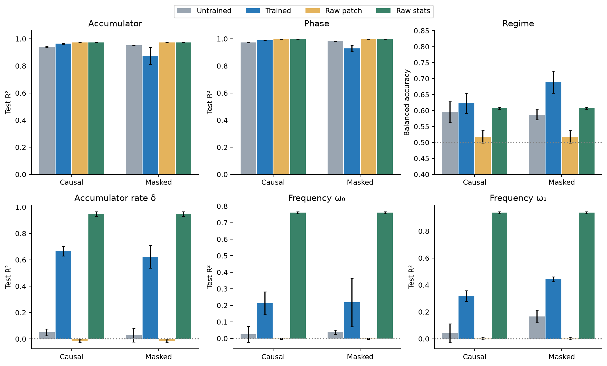
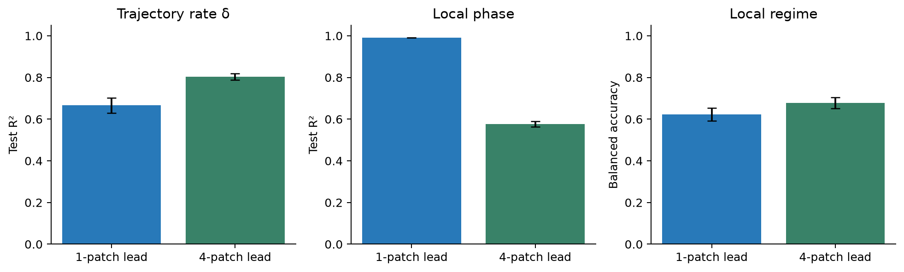

# Synthetic results and their implications for EEG representations

The synthetic experiments show that these small Transformers can learn useful temporal features, but waveform reconstruction quality, latent recovery and downstream usefulness measure different things. Pretraining substantially improves access to some trajectory parameters, while several impressive local-state scores are already present in an untrained encoder. Making prediction harder changes which factors are accessible; it does not improve every factor together.

This provides a useful interpretation of the EEG findings: successful reconstruction alone is insufficient evidence of a useful dementia representation. Conversely, weak diagnosis accuracy does not imply that an encoder learned nothing. The window-level EEG spectral probe supplies direct evidence of partial frequency information, especially when patch standard deviation is retained.

This synthesis uses the completed **24-run synthetic study**, rather than the earlier smoke runs. No models were retrained for this report. Values are held-out test results; synthetic “±” values are sample standard deviations across three paired simulation/model seeds, not confidence intervals. Values displayed as 0.000 are rounded, not necessarily exactly zero.

## What was simulated

Three systems separate recovering a visible state, estimating a sequence-wide parameter, and predicting a transition. They are deliberately simple diagnostic systems, not physiological EEG simulations.

| System | How the signal is generated | What the test asks |
|---|---|---|
| Oscillatory AR(2) | A noisy oscillator whose next value depends on its previous two values | Can the encoder preserve current state and reveal damping and oscillation frequency? |
| Predictable switching oscillator | A rising accumulator triggers switches between two oscillation frequencies when it crosses a threshold | Can the encoder recover state, distinguish regimes and estimate parameters associated with predictable transitions? |
| Random switching oscillator | Switches occur randomly; a visible accumulator resets at switches | Can it represent the oscillator and transition statistics when the exact next switch is unpredictable? |

Each trajectory contains **128 samples and three channels**. The AR(2) recurrence is

\[
z_t=2r\cos(\omega)z_{t-1}-r^2z_{t-2}+\epsilon_t.
\]

The damping parameter \(r\) and frequency \(\omega\) are sampled once per trajectory. Innovation noise changes at every step. In the default observation mapping, the three channels are noisy copies of the current scalar state; the probed AR state is \((z_t,z_{t-1})\). This makes state preservation a different and generally easier problem than estimating \(r\) or \(\omega\).

For the switching systems, the default three-channel observation is

\[
x_t=\begin{bmatrix}\cos\phi_t\\\sin\phi_t\\0.6u_t\end{bmatrix}+\eta_t,
\qquad
\phi_{t+1}=(\phi_t+\omega_{q_t})\bmod 2\pi.
\]

Here \(u_t\) is an accumulator and \(q_t\in\{0,1\}\) chooses the frequency. The initial accumulator, phase and regime are randomized. Four parameters are sampled independently and uniformly once per trajectory: accumulator increment \(\delta\in[0.025,0.05]\), threshold \(\tau\in[0.9,1.1]\), and frequencies \(\omega_0\in[0.12,0.2]\), \(\omega_1\in[0.35,0.5]\), in radians per sample.

In the predictable system, add \(\delta\) each step; when \(u_t+\delta\geq\tau\), flip the regime and subtract \(\tau\) from the accumulator. Otherwise keep the regime. In the random system, flip with probability \(h=\delta/\tau\) independently at each step; reset the accumulator to zero on a switch and otherwise increment it. Thus \(\tau\) is **not an active crossing threshold in the random system**: it affects the switching probability through \(h\). The saved hazard target is derived from \(\delta,\tau\), not an independently sampled factor.

This observation design explains why some factors are easy. Phase is scored as its sine/cosine pair, already present in two channels; the scaled accumulator is present in the third. Regime is not a separate observation channel and must be inferred from temporal frequency evidence. Sequence-wide frequencies, rates and thresholds require statistical estimation. Exact random switch timing remains unpredictable even if its probability is known. EEG has no corresponding guarantee that its physiological factors are directly observed in separate channels.

## What the models and probes measured

The study used 512 training, 128 validation and 128 independent test trajectories per seed. Three paired data/model seeds produced eight conditions each: causal and masked models for all three systems, plus longer-horizon causal and longer-span masked variants for predictable switching.

The shared architecture has four-sample patches, width 32, two Transformer layers, four attention heads and 26,316 allocated parameters. Each model completed **100 epochs, or 1,600 optimizer updates**, with AdamW and batch size 32. A validation-only rule extended the common budget from 50 epochs; each run selected its own best validation reconstruction checkpoint. The common update budget does not match target counts or compute across tasks.

Causal training predicts a future four-sample waveform patch from at most eight past/current patches. The default lead is one patch; the variant uses four. For example, a source endpoint at samples 28–31 predicts samples 32–35 at lead one and 44–47 at lead four. The target remains one patch. Masked training reconstructs hidden waveform values at 50% masking, with requested spans of two patches or four in the variant. Adjacent selected blocks can merge. Both decoders predict signal values, not embeddings.

Frozen **linear ridge probes** estimate continuous states and parameters; a binary logistic probe predicts regime. All feature/target scaling uses training trajectories, with probe regularization selected on validation data. Local probes predict the state at a patch’s final sample. Sequence probes use the arithmetic mean of patch embeddings to predict a parameter shared by that trajectory. For local recovery, reported pooled R² combines test patches across trajectories; parameter R² is calculated across the 128 independent test trajectories. Pooled local R² can include both within- and between-trajectory variation.

During probing, the masked encoder sees the entire **unmasked** sequence, including future samples. The causal encoder sees bounded past/current context. This is an information-access difference, so a higher local recovery score is not an equal-information contest between objectives.

| Feature source | Meaning |
|---|---|
| Trained encoder | Frozen embeddings after waveform SSL training |
| Untrained encoder | Same architecture and identical initial weights, before training; the probe is still trained |
| Raw patch | Flattened current patch locally; mean of flattened patches for sequence targets |
| Raw statistics | Current patch plus bounded-past mean, std and lag correlations locally; whole-sequence mean, std and lag correlations for sequence targets |

Raw local controls use no future observations. Sequence statistics use all observations. These controls measure what a simple readout can recover without SSL; they are not latent labels or inputs supplied to the encoder during training.

## Reconstruction succeeds on the toy tasks

| Synthetic task | Neural MSE | Eligible simple baseline MSE | MSE reduction |
| --- | --- | --- | --- |
| AR(2), causal | 0.099 ± 0.006 | 0.496 ± 0.005 | 80.1% |
| AR(2), masked | 0.419 ± 0.062 | 0.932 ± 0.052 | 55.0% |
| Predictable, causal | 0.127 ± 0.000 | 0.785 ± 0.016 | 83.8% |
| Predictable, masked | 0.244 ± 0.008 | 1.133 ± 0.002 | 78.4% |
| Random, causal | 0.089 ± 0.010 | 0.511 ± 0.004 | 82.7% |
| Random, masked | 0.251 ± 0.017 | 0.818 ± 0.017 | 69.3% |
| Predictable, 4-patch causal lead | 0.275 ± 0.008 | 2.390 ± 0.027 | 88.5% |
| Predictable, 4-patch mask span | 0.337 ± 0.017 | 1.524 ± 0.006 | 77.9% |

The causal baseline is persistence: repeat the last visible sample. The masked baseline is linear interpolation using visible samples on either side, with one-sided filling at edges. MSE uses training-normalized observations and is evaluated only on each task’s eligible targets. The percentage is \(100(1-\overline{\mathrm{MSE}}_{\rm model}/\overline{\mathrm{MSE}}_{\rm baseline})\), calculated from seed means.

All eight neural conditions beat their corresponding simple baseline. This establishes learnability within the finite budget; it does not rank causal against masked. Forecasting and interpolation have different visible information and target sets. The synthetic causal task also differs materially from the EEG causal task: one future patch versus a direct multi-second future block.

## High state recovery is partly present before pretraining

| Task | Accumulator R² | Phase R² | Regime balanced accuracy |
| --- | --- | --- | --- |
| Predictable, causal | 0.963 ± 0.003 | 0.990 ± 0.000 | 0.623 ± 0.031 |
| Predictable, masked | 0.875 ± 0.063 | 0.930 ± 0.022 | 0.689 ± 0.034 |
| Random, causal | 0.991 ± 0.001 | 0.996 ± 0.000 | 0.722 ± 0.030 |
| Random, masked | 0.891 ± 0.027 | 0.927 ± 0.011 | 0.729 ± 0.014 |

AR(2) local-state R² is **0.993 ± 0.001 causal** and **0.962 ± 0.013 masked**. Yet the paired change from initialization is only +0.020 for causal and −0.016 for masked. In predictable switching, causal phase R² is 0.990 but increases by only +0.017 relative to initialization. Masked accumulator and phase R² remain high after training, but their changes are −0.077 and −0.052 respectively. Regime balanced accuracy improves by +0.028 causal and +0.102 masked; binary balanced-accuracy chance is 0.5.

These results separate a representation’s absolute readout score from the information made more accessible by training. Directly visible signals can survive random projections and the untrained architecture. A negative trained-minus-untrained change means this linear readout became worse; it does not establish that the encoder discarded the information entirely.

The strong local scores in the random system are compatible with unpredictable switch timing: recovering the current observed state and predicting the next random transition are different tasks. Likewise, a high pooled accumulator score need not imply precise tracking of every within-trajectory change.



*Bars show seed means; error bars are sample SD over three paired seeds. Local state and sequence parameters have separate panels and scales. Regime uses balanced accuracy, while the other panels use R². Dashed reference lines mark chance or zero R².*

## Training helps some sequence parameters but trails engineered statistics

| Predictable system features | Phase R² | δ R² | τ R² | ω₀ R² | ω₁ R² |
| --- | --- | --- | --- | --- | --- |
| Untrained causal | 0.973 | 0.050 | 0.863 | 0.024 | 0.042 |
| Trained causal | 0.990 | 0.666 | 0.901 | 0.214 | 0.317 |
| Raw patch | 0.999 | -0.015 | 0.825 | -0.003 | 0.003 |
| Raw statistics | 0.999 | 0.948 | 0.912 | 0.760 | 0.937 |

For predictable switching, causal training increases rate recovery from **0.050 to 0.666 R²**, a much larger gain than its phase improvement. Threshold recovery is already 0.863 in the untrained encoder and reaches 0.901. In AR(2), trained frequency recovery reaches **0.825 ± 0.032 causal** and **0.829 ± 0.034 masked**, while damping recovery is weaker: 0.423 and 0.280.

The raw-statistics control is stronger on several important parameters: predictable-system rate R² is 0.948, and the two frequency scores are 0.760 and 0.937. AR(2) frequency R² from raw statistics is 0.956. Adding variability and lag information exposes temporal parameters much more effectively than mean-pooled raw patches. The trained representation therefore does not make all available statistical information as linearly accessible as these engineered features.

Predictable switching also makes some parameters easier to estimate than random switching. Causal rate recovery falls from 0.666 to 0.141, and threshold recovery from 0.901 to 0.015. This is consistent with their changed role in the dynamics; it is not a clean test of predictability alone because accumulator resetting and observation distributions change too. In particular, the random system’s threshold has only an indirect statistical role through hazard.

## Longer prediction changes the represented factors

| Predictable task | δ R² | Phase R² | Regime balanced accuracy |
| --- | --- | --- | --- |
| Causal, 1-patch lead | 0.666 ± 0.036 | 0.990 ± 0.000 | 0.623 ± 0.031 |
| Causal, 4-patch lead | 0.804 ± 0.016 | 0.576 ± 0.013 | 0.677 ± 0.026 |
| Masked, 2-patch span | 0.623 ± 0.085 | 0.930 ± 0.022 | 0.689 ± 0.034 |
| Masked, 4-patch span | 0.586 ± 0.135 | 0.890 ± 0.035 | 0.713 ± 0.013 |



Increasing causal lead from one to four patches improves rate recovery by **0.138 R²** and regime balanced accuracy by **0.054**, while reducing local phase recovery by **0.414 R²**. A representation suited to a longer forecast may emphasize slower trajectory properties over the current phase; this is a plausible interpretation of the observed tradeoff, not a demonstrated internal mechanism. Increasing masked span likewise improves regime recovery while reducing local-state scores, without a uniform gain in trajectory parameters.

The defensible conclusion is that task design selects which factors are useful to a readout. “Harder reconstruction creates better representations” is too broad for these results.

## How this helps explain the EEG results

| Synthetic evidence | Relevant EEG finding | Interpretation supported by the comparison |
|---|---|---|
| Neural reconstruction beats simple baselines, but recovery differs sharply by factor | EEG reconstruction quality and dementia balanced accuracy do not improve together consistently | Evaluate the information needed for the scientific question directly; reconstruction loss is an insufficient surrogate |
| High local-state scores often occur before training | Untrained EEG encoders give nontrivial diagnosis and spectral readouts | Compare against the paired initialization before attributing an absolute score to SSL |
| Raw mean/std/lag features outperform embeddings for several trajectory parameters | Handcrafted EEG spectral classification reaches 66.0% balanced accuracy; the central mean-pooled learned models are lower | Domain statistics remain a strong benchmark; an objective or readout can leave useful observed structure less accessible |
| Mean-pooled raw patches lose access to frequency/rate information that statistics expose | EEG masked spectral R² rises from 0.095 with mean pooling to 0.251 with mean+std | Retaining embedding variation can materially change a probe result; it does not change the frozen encoder |
| Longer lead/span trades off local state against other factors | Longer EEG causal context/shorter prediction and higher masking ratios do not consistently improve diagnosis | Greater prediction difficulty is not a universal objective; context, missingness and target duration must be interpreted together |

The latest EEG spectral probe is the most direct bridge. It predicts channel-averaged relative delta, theta, alpha, beta and restricted 30–45 Hz gamma power for each four-second window, on held-out participants. With mean+std pooling, the masked encoder reaches **0.251 average test R² versus 0.092 untrained**; causal reaches **0.094 versus 0.081 untrained**. The masked trained-minus-untrained gain is +0.160 with a paired participant-bootstrap interval of [+0.052, +0.212], conditional on this one seed and fitted probes. These results show partial spectral accessibility, not high-fidelity spectrum recovery or established dementia usefulness.

Pooling also has task-specific effects. For the EEG masked 50 ms/25% condition, mean+std improves this seed’s spectral probe but the separate three-seed diagnosis analysis changes from **39.9% to 32.9% balanced accuracy**. Different targets, evaluation units and seed summaries prevent a paired causal interpretation, but the contrast reinforces that spectral accessibility and diagnostic accuracy are distinct outcomes. The approximately 2:1 causal diagnosis model benefits from mean+std pooling (41.2% to 49.3%); other configurations do not show a consistent benefit.

The synthetic evidence does **not** establish that EEG failure comes from interpolation shortcuts, inadequate data, an unsuitable architecture, insufficient training or biological unpredictability. Those remain possible explanations requiring targeted tests. In EEG, many short-gap reconstructions trail visible-sample interpolation, whereas all synthetic conditions beat their corresponding simple baseline. That difference cautions against treating the toy systems as a quantitative forecast of EEG performance.

## Limits that matter for the explanation

Ten synthetic runs still improved their best validation loss by at least 2% between the final two ten-epoch windows; all ten were masked conditions. These are finite-budget results, not a comparison of fully converged optima. The earlier smoke runs are implementation checks: their broadly negative parameter R² should not be used as the final performance estimate. The larger study also changed sequence length and accumulator ranges, so improvement over smoke cannot be assigned to training duration alone.

R² describes prediction error relative to the evaluation targets’ mean. Positive R² indicates partial linear recovery; negative R² means this probe predicts worse than that mean reference. It does not prove that the information is absent or that a nonlinear readout could not recover it. A negative *difference* in R² from initialization is a separate statement from negative absolute R².

Three paired seeds provide descriptive variability; data generation and initialization change together, so their effects are not separated. Synthetic test units are independently generated trajectories, while EEG test units are held-out people with correlated windows. Synthetic sample numbers and EEG seconds have no direct conversion. The EEG test panel has also been examined repeatedly, making its comparisons exploratory.

## Suggested wording for a presentation or discussion

> The synthetic experiments validated that waveform self-supervision can make selected temporal parameters more linearly accessible. However, high local-state recovery was often already present before pretraining, engineered observation statistics remained strong, and longer prediction changed which factors were recovered rather than improving all of them. We therefore interpret EEG reconstruction loss, spectral recovery and dementia classification separately. The EEG encoders retain some spectral information, particularly when patch variability is preserved, but this has not translated into a consistent diagnostic advantage over handcrafted spectral features.

## Evidence and reproduction

- [Original synthetic findings](research_results.md), [paired-study protocol](research_protocol.md), [configuration](../configs/research.json).
- Portable [aggregate table](synthetic_summary_assets/aggregate_metrics.csv) and [individual-seed table](synthetic_summary_assets/seed_metrics.csv). These are unchanged copies of `results/research/analysis/`; the figures and numerical tables use their full-precision values.
- Vector figures for slides or export: [state and parameter controls](synthetic_summary_assets/predictable_controls.pdf), [causal horizon tradeoff](synthetic_summary_assets/horizon_tradeoff.pdf).
- Generator equations: [data.py](../temporal_ssl/data.py); model access/training: [models.py](../temporal_ssl/models.py); probe definitions and controls: [probes.py](../temporal_ssl/probes.py).
- EEG [central reconstruction and classification comparison](eeg_reconstruction_extended.md), [pooling analysis](eeg_pooling.md), and [window-level spectral probe](eeg_window_spectral.md).

Rebuild the two figures, including vector PDFs, and validate the aggregate numerical table against individual seeds:

```bash
OPENBLAS_NUM_THREADS=1 .venv-gpu/bin/python reports/synthetic_summary_assets/build_figures.py
```

All existing model checkpoints, experiments and reports are preserved. This report adds interpretation and portable figures without new training or test-set model selection.
